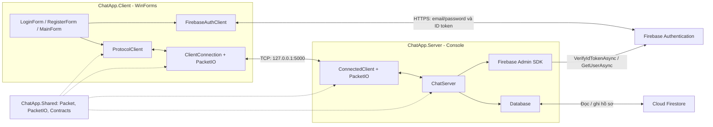
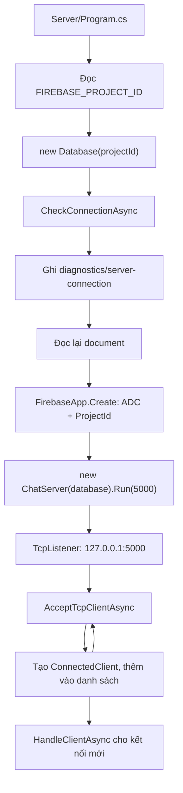
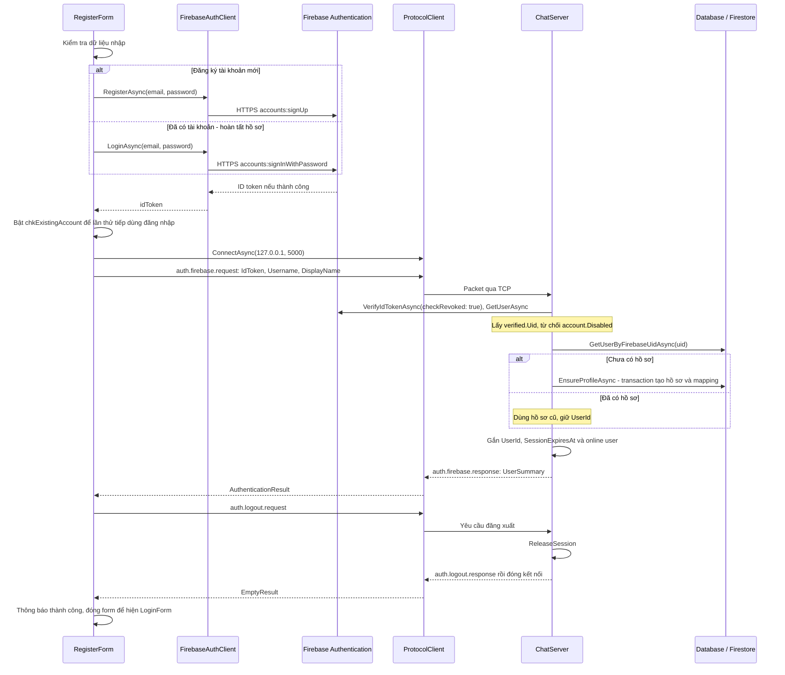
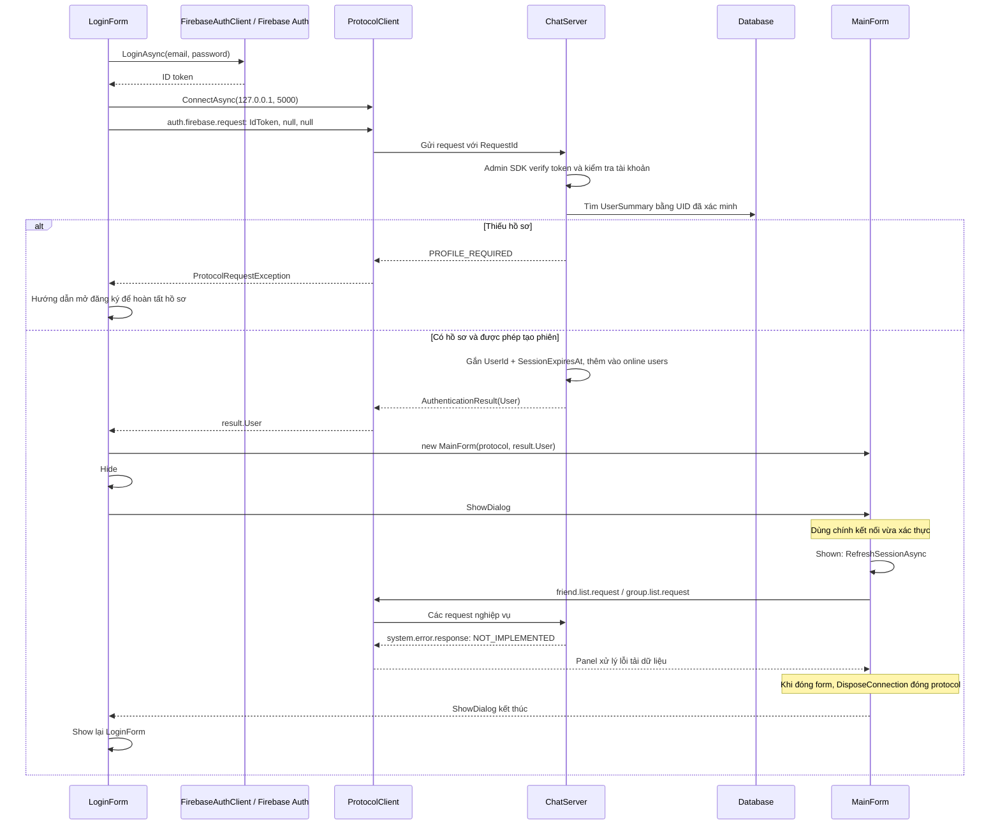
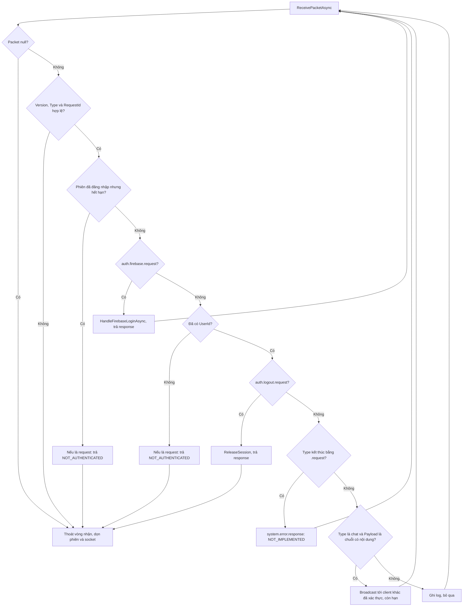
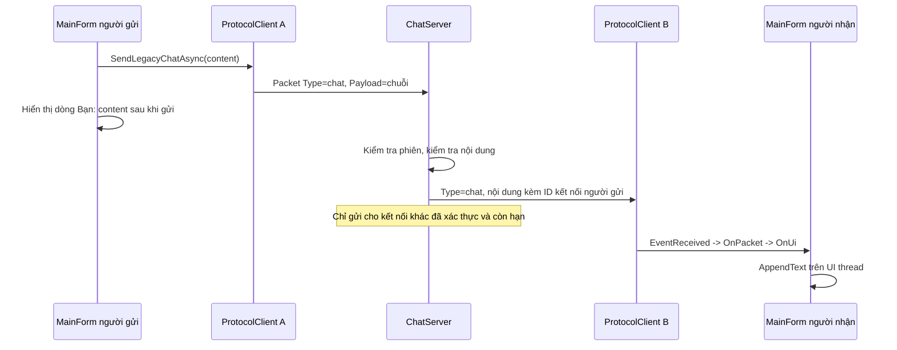

# ChatApp.Nhom1

Đồ án nhắn tin bằng **C# / .NET 10**, giao diện **WinForms**, giao tiếp **TCP**, xác thực bằng **Firebase Authentication** và lưu dữ liệu bằng **Cloud Firestore**.

README mô tả source tại ngày **10/11/2026**. Các trạng thái bên dưới phản ánh code đã có và các điểm đã nối với nhau; không thay thế kết quả kiểm thử thực tế với Firebase.

## 1. Kiến trúc ứng dụng

Solution [ChatApp.Nhom1.slnx](ChatApp.Nhom1.slnx) gồm ba project:

| Project | Framework | Trách nhiệm |
|---|---|---|
| [ChatApp.Client](ChatApp.Client/ChatApp.Client.csproj) | `net10.0-windows` | Form đăng ký/đăng nhập, gọi Firebase qua HTTPS, gửi request TCP và hiển thị tin nhắn |
| [ChatApp.Server](ChatApp.Server/ChatApp.Server.csproj) | `net10.0` | Nhận kết nối TCP, xác minh token, quản lý phiên, truy cập Firestore và broadcast chat demo |
| [ChatApp.Shared](ChatApp.Shared/ChatApp.Shared.csproj) | `net10.0` | `Packet`, `PacketIO`, DTO xác thực và DTO nghiệp vụ dùng chung |

Client và Server đều tham chiếu Shared; Shared không tham chiếu ngược lại. Server đang dùng `FirebaseAdmin 3.7.0` và `Google.Cloud.Firestore 4.6.0`.



Client có hai đường giao tiếp: gọi Firebase Authentication qua HTTPS để lấy ID token, rồi gửi token đến ChatServer qua TCP để đăng nhập vào ứng dụng. Client không truy cập Firestore trực tiếp trong luồng hiện tại.

## 2. Các thành phần chính trong source

| File / thành phần | Vai trò trong luồng hiện tại |
|---|---|
| [Client/Program.cs](ChatApp.Client/Program.cs) | Khởi động WinForms bằng `Application.Run(new LoginForm())` |
| [LoginForm.cs](ChatApp.Client/Forms/LoginForm.cs) | Đăng nhập Firebase, xác thực socket rồi bàn giao kết nối và user cho MainForm |
| [RegisterForm.cs](ChatApp.Client/Forms/RegisterForm.cs) | Tạo tài khoản hoặc đăng nhập để hoàn tất hồ sơ; gửi hồ sơ qua TCP, logout rồi quay lại LoginForm |
| [FirebaseAuthClient.cs](ChatApp.Client/FirebaseAuthClient.cs) | Gọi REST `signUp` / `signInWithPassword`; nhận ID token; timeout HTTP 20 giây |
| [AuthMessages.cs](ChatApp.Client/AuthMessages.cs) | Chuyển mã lỗi Firebase thành thông báo cho người dùng |
| [ProtocolClient.cs](ChatApp.Client/ProtocolClient.cs) | Tạo RequestId, chờ response, quản lý một vòng nhận, phát event và báo mất kết nối; timeout mặc định 10 giây |
| [ClientConnection.cs](ChatApp.Client/ClientConnection.cs) | Quản lý TcpClient và NetworkStream thông qua PacketIO |
| [Server/Program.cs](ChatApp.Server/Program.cs) | Đọc cấu hình, kiểm tra Firestore, khởi tạo Firebase Admin và chạy server |
| [ChatServer.cs](ChatApp.Server/ChatServer.cs) | Accept client, phân nhánh packet, kiểm tra token/phiên, trả response và broadcast |
| [ConnectedClient.cs](ChatApp.Server/ConnectedClient.cs) | Giữ socket, ID kết nối, UserId đã xác thực và SessionExpiresAt |
| [Database.cs](ChatApp.Server/Database.cs) | Đọc/ghi Firestore; tạo hồ sơ bằng transaction; có sẵn hàm lưu tin và lấy lịch sử chưa nối vào dispatcher |
| [MainForm.cs](ChatApp.Client/Forms/MainForm.cs) | Sở hữu kết nối sau login, hiển thị chat demo và chứa FriendsPanel/GroupChatPanel |
| [PacketIO.cs](ChatApp.Shared/PacketIO.cs) | Đóng khung JSON thành byte để gửi/đọc qua stream; khóa ghi để các packet không bị xen byte |
| [Contracts](ChatApp.Shared/Contracts/Authentication.cs) | DTO xác thực; DTO bạn bè/nhóm/tin nhắn nằm trong [FriendsAndGroups.cs](ChatApp.Shared/Contracts/FriendsAndGroups.cs) |

## 3. Luồng khởi động server



Server chỉ bắt đầu lắng nghe sau khi bước kiểm tra đọc/ghi Firestore hoàn tất. Dòng “Nhấn Ctrl+C để dừng server” được in trước các bước này, nên chưa phải tín hiệu server đã sẵn sàng. Ctrl+C yêu cầu hủy và dừng listener.

## 4. Luồng đăng ký và hoàn tất hồ sơ

Email/mật khẩu thuộc Firebase Authentication. Username/DisplayName và UserId số nguyên thuộc hồ sơ ứng dụng trong Firestore. Một tài khoản Firebase có thể đã tạo thành công dù bước tạo hồ sơ hoặc kết nối TCP sau đó bị lỗi.



Sơ đồ thể hiện đường thành công; lỗi Firebase hoặc server được form bắt và hiển thị. Nếu tài khoản đã có nhưng hồ sơ chưa hoàn tất, chọn chế độ hoàn tất hồ sơ để đăng nhập lại và gửi hồ sơ. Không cần tạo tài khoản Firebase lần nữa.

## 5. Luồng đăng nhập và mở MainForm



Server trả `ALREADY_ONLINE` nếu UserId đã có trong danh sách online, và `ALREADY_AUTHENTICATED` nếu đăng nhập lại trên socket đã xác thực. Phiên được gắn vào **kết nối TCP**, nên mở socket khác không tự kế thừa đăng nhập.

Hai cách kết thúc kết nối hiện có khác nhau: RegisterForm gửi `auth.logout.request`; nút **Ngắt kết nối** của MainForm gọi `ProtocolClient.Disconnect()` trực tiếp. Khi mất/đóng socket, server dọn phiên trong `finally`. MainForm xóa user khỏi trạng thái UI khi nhận sự kiện Disconnected.

## 6. Server xử lý packet như thế nào?



RequestId phải là GUID đối với gói có hậu tố `.request`. Server kiểm tra hạn phiên khi xử lý packet, đồng thời lọc người nhận broadcast theo SessionExpiresAt. Chưa có luồng tự làm mới token hoặc tự đăng nhập lại.

## 7. Luồng chat demo và định dạng TCP



Chat demo **chưa gọi Database.SendMessageAsync**, nên không lưu lịch sử vào Firestore và chưa có xác nhận đã lưu/đã xem. Dòng tin phía người gửi chỉ phản ánh việc client đã gửi; server không gửi response xác nhận cho gói demo. ID hiển thị trong `Client {Id} gửi: ...` là ID kết nối, không phải UserId nghiệp vụ.

Mỗi packet trên TCP được truyền như sau:

```text
[4 byte độ dài JSON, big-endian] [JSON UTF-8]
```

- Envelope: `Version`, `Type`, `RequestId`, `Payload`; Version hiện tại là `1`.
- Giới hạn phần JSON: **1 MiB**. PacketIO đọc đủ header/body và khóa ghi từng frame.
- ProtocolClient có một vòng nhận cho mỗi kết nối. Response được ghép bằng RequestId; packet có RequestId null được chuyển sang EventReceived.
- Response nghiệp vụ: `{Success, Data, Error}`. `system.error.response` có Payload trực tiếp `{Code, Message}`.
- Timeout request không chứng minh thao tác chưa được server lưu; không tự gửi lại thao tác tạo mới khi chưa xác định kết quả.

## 8. Dữ liệu và trạng thái triển khai

Các đường dẫn Firestore đang được Database sử dụng:

| Document / collection | Vai trò và điểm sử dụng |
|---|---|
| `diagnostics/server-connection` | Program ghi/đọc để kiểm tra kết nối khi khởi động |
| `authUsers/{escapedUid}` | Ánh xạ Firebase UID sang UserId int |
| `users/{id}` | Hồ sơ: Id, FirebaseUid, Username, DisplayName, CreatedAt |
| `usernames/{normalizedName}` | Giữ username duy nhất, trỏ tới UserId |
| `counters/users` | LastId; cập nhật trong transaction tạo hồ sơ |
| `messages/{id}`, `counters/messages` | Hàm SendMessageAsync đã có transaction lưu tin; chưa được ChatServer gọi |
| `friendship/{minId}_{maxId}` | Tên collection đang được SendMessageAsync dùng để kiểm tra quan hệ Accepted |
| `groups/{id}` | Hàm database đọc MemberIds để kiểm tra quyền gửi/đọc tin nhóm |

`EnsureProfileAsync` tạo counter, profile, mapping UID và username trong cùng transaction. `GetHistoryAsync` truy vấn messages theo ConversationKey và Id để phân trang; hiện cũng chưa được nối vào handler TCP. Danh sách kết nối và `_onlineUsers` chỉ nằm trong RAM của server.

| Chức năng | Trạng thái theo source |
|---|---|
| Đăng ký / đăng nhập Email + Mật khẩu | Đã nối form → Firebase Auth → TCP → xác minh token → hồ sơ Firestore |
| Hoàn tất hồ sơ còn thiếu | Có PROFILE_REQUIRED và checkbox dùng tài khoản Firebase hiện có |
| Quản lý phiên | Có UserId, SessionExpiresAt, giới hạn một kết nối/user, giải phóng khi logout/ngắt kết nối |
| Chat chung demo | Có broadcast giữa các kết nối đã xác thực; chưa lưu database |
| Bạn bè, tìm người, nhóm, thành viên | Có UI và lời gọi request; server chưa có handler, trả NOT_IMPLEMENTED |
| Chat riêng / nhóm có lưu tin, lịch sử | Có DTO, một số UI và hàm Database; chưa có luồng xuyên suốt client–server |
| Google / SĐT, typing/read, file/ảnh/video, thông báo nền | Chưa có luồng triển khai đầy đủ |
| TLS trên kết nối chat | Chưa có; TCP đang dùng NetworkStream |

Các giới hạn đang thấy trong source:

- Nút **Demo chat** vẫn mở MainForm không có user. Kết nối TCP từ đây không tự đăng nhập, nên server sẽ từ chối gửi chat khi chưa có UserId. Để thử broadcast, đăng nhập hai tài khoản khác nhau.
- MainForm tự tải bạn bè/nhóm sau login nên có thể hiển thị NOT_IMPLEMENTED; lỗi đó không đồng nghĩa Firebase login thất bại.
- Username trong Database giới hạn 3–20 ký tự chữ/số/underscore; RegisterForm hiện chỉ nhận chữ/số. Bước so sánh mật khẩu đăng ký còn Trim dù mật khẩu gửi Firebase giữ nguyên.
- `_clients.Remove` chưa dùng cùng khóa với Add/snapshot. Một số thông báo mã lỗi và xử lý khi đóng form đang await cần hoàn thiện.

## 9. Cấu hình và chạy

Cần Windows với .NET 10 SDK để chạy WinForms, project Firebase đã bật Email/Password, Firestore và service account có quyền phục vụ các thao tác hiện tại. Có thể mở solution bằng Visual Studio hỗ trợ .NET 10 với workload **.NET desktop development**; Shared là thư viện, không đặt làm startup project.

| Biến môi trường | Tiến trình sử dụng | Ý nghĩa |
|---|---|---|
| `FIREBASE_PROJECT_ID` | Server | Project ID dùng cho Firestore và Firebase Admin |
| `GOOGLE_APPLICATION_CREDENTIALS` | Server | Đường dẫn JSON service account, đặt ngoài repository |
| `FIREBASE_WEB_API_KEY` | Client | Web API Key của cùng project, dùng gọi Firebase Auth REST |

Tại thư mục solution, build:

```powershell
dotnet build .\ChatApp.Nhom1.slnx
```

Terminal PowerShell thứ nhất, cấu hình rồi chạy server:

```powershell
$env:FIREBASE_PROJECT_ID = "YOUR_FIREBASE_PROJECT_ID"
$env:GOOGLE_APPLICATION_CREDENTIALS = "C:\duong-dan\firebase-service-account.json"
dotnet run --project .\ChatApp.Server\ChatApp.Server.csproj
```

Terminal PowerShell thứ hai, cấu hình rồi chạy client:

```powershell
$env:FIREBASE_WEB_API_KEY = "YOUR_FIREBASE_WEB_API_KEY"
dotnet run --project .\ChatApp.Client\ChatApp.Client.csproj
```

Các lệnh `$env:...` áp dụng cho terminal hiện tại và chương trình được mở từ terminal đó. Nếu chạy bằng F5, cung cấp biến cho tiến trình debug/IDE; sau khi lưu biến ở cấp User, mở lại IDE để nhận môi trường mới.

Đợi server báo đang chờ tại `127.0.0.1:5000`, sau đó đăng ký hoặc đăng nhập từ LoginForm. Đăng ký thành công quay lại form đăng nhập; login thành công mở MainForm. Dùng Ctrl+C để dừng server.

LoginForm và RegisterForm hiện cố định địa chỉ `127.0.0.1:5000`. MainForm có ô máy chủ/cổng nhưng không thay đổi cấu hình của hai form xác thực. Muốn chạy LAN cần cập nhật cả địa chỉ kết nối, địa chỉ lắng nghe, firewall và bổ sung TLS cho đường truyền token.

Không commit service-account JSON, mật khẩu hoặc token. Giữ `.Designer.cs` và `.resx` trong Git; bỏ qua `.vs`, `bin`, `obj` và dữ liệu người dùng tải lên.

## 10. Tài liệu liên quan

- [Hướng dẫn triển khai Firebase Authentication cho giữa kỳ](docs/xac-thuc-firebase-giua-ky.vi.md)
- [Thiết kế và tích hợp Cloud Firestore](docs/tich-hop-firebase.vi.md)
- [Đặc tả protocol](docs/protocol.md), [JSON Schema](docs/protocol.schema.json), [gói mẫu](docs/protocol.examples.jsonl)
- [UI bạn bè và nhóm](docs/friends-and-groups.md)

Các tài liệu thiết kế có thể mô tả chức năng dự kiến; đối chiếu với bảng trạng thái và handler trong source trước khi dùng làm bằng chứng đã hoàn thành. Các file SQL trong thư mục `database/` không được Program/Database hiện tại dùng để kết nối dữ liệu.
