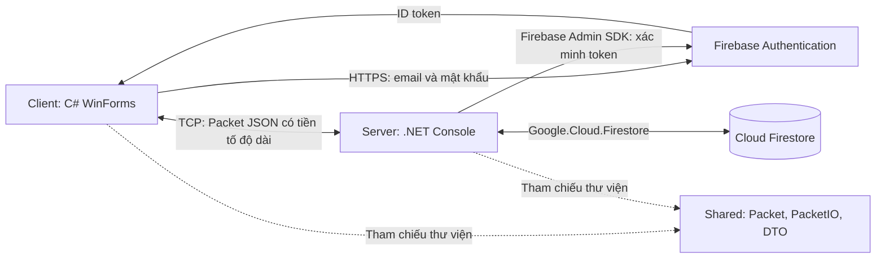

# Chuẩn bị báo cáo giữa kỳ NEXUS X — Nhóm 1

Đối chiếu source trong `Do_an` ngày 11/11/2026, HEAD `8a95241`. Người dùng xác nhận đây là bản báo cáo; thời lượng 10–15 phút. Tài liệu này là nội dung để dựng PowerPoint và tập thuyết trình, chưa phải file `.pptx`.

Đã đọc các luồng Client, Server, Shared và build bằng `dotnet build ChatApp.Nhom1.slnx --no-restore`: thành công, 0 warning, 0 error. Chưa chạy kiểm thử đăng ký/đăng nhập với Firebase thật; các trạng thái dưới đây là kết luận từ source, không phải biên bản nghiệm thu. Chưa sửa source ứng dụng.

## 1. Kết luận để nhóm thống nhất

Cách hiểu ban đầu đúng về công nghệ. Cần chỉnh cách diễn đạt Shared và bổ sung giao tiếp TCP, giao thức gói tin, xác minh token, quản lý phiên và bằng chứng kiểm thử.

**Câu giới thiệu có thể dùng:**

> NEXUS X là ứng dụng chat desktop viết bằng C# và .NET 10, theo kiến trúc client–server. Client dùng Windows Forms; server chạy dưới dạng console application, tiếp nhận kết nối TCP và xử lý yêu cầu. Hai project tham chiếu thư viện Shared để thống nhất cấu trúc dữ liệu và cách đóng gói tin. Firebase Authentication quản lý tài khoản email/mật khẩu; server xác minh ID token rồi đọc hoặc tạo hồ sơ người dùng trong Cloud Firestore.

Shared là **class library**, không phải tiến trình trung gian và không có một kết nối Client → Shared → Server. Ba project không tự động đồng nghĩa với kiến trúc ba tầng hoặc MVC.

Mốc giữa kỳ đã có luồng xác thực được nối trong source. Chỉ chốt “đã hoàn thành và kiểm thử” khi chạy đạt các ca trong mục 7. Không dùng tỷ lệ hoàn thành phần trăm nếu chưa có danh sách công việc và cách tính.

## 2. Kiến trúc đúng với source



Mũi tên nét đứt là quan hệ tham chiếu mã, không phải đường truyền mạng. Việc xác minh token do Admin SDK thực hiện; không nên diễn giải thành mỗi lần kiểm tra chữ ký đều phải gửi token lên Firebase. Source còn yêu cầu kiểm tra thu hồi và đọc tài khoản.

| Thành phần | Thực tế đang dùng | Vai trò cần nói |
|---|---|---|
| Client | `net10.0-windows`, `UseWindowsForms=true` | Form, thao tác người dùng, gọi Auth REST, gửi request TCP, hiển thị phản hồi |
| Server | `net10.0`, console application | `TcpListener`, xử lý nhiều kết nối bất đồng bộ, kiểm tra token, quản lý phiên và truy cập dữ liệu |
| Shared | `net10.0`, class library | `Packet`, `PacketIO`, DTO trong `Contracts`; cả hai đầu dùng cùng quy ước |
| Firebase Authentication | REST phía client; FirebaseAdmin 3.7.0 phía server | Tạo tài khoản, đăng nhập email/mật khẩu và xác minh danh tính |
| Cloud Firestore | Google.Cloud.Firestore 4.6.0 | Hồ sơ, ánh xạ UID; đã có code dữ liệu tin nhắn nhưng chưa nối handler |
| Giao tiếp | TCP socket; JSON UTF-8 | Client–server dùng protocol tự xây dựng; HTTPS là đường riêng đến Firebase Auth |

“Console” là hình thức chạy server, không phải giao thức. “Form” là công nghệ giao diện, không phải kiến trúc tổng thể. SQL script còn trong repository nhưng không được đường chạy hiện tại dùng làm database.

**Điểm chuyên môn của môn Lập trình mạng:**

- `TcpListener` tiếp nhận kết nối; mỗi client có một `ConnectedClient`, xử lý bằng `async/await`.
- TCP truyền dòng byte, không giữ ranh giới từng thông điệp. `PacketIO` thêm header 4 byte big-endian chứa độ dài, sau đó là JSON UTF-8.
- Hàm đọc lặp tới khi đủ header/body; một lần `ReadAsync` có thể chỉ trả về một phần dữ liệu.
- `SemaphoreSlim` tuần tự hóa việc ghi trên cùng kết nối; giới hạn mỗi packet là 1 MiB.
- `RequestId` giúp `ProtocolClient` ghép response với request; có vòng nhận chung và timeout mặc định 10 giây.
- Danh tính là `UserId` gắn vào phiên sau khi server xác minh token, khác `Id` của kết nối demo.
- Server hiện bind `127.0.0.1:5000`; nhiều client trên cùng máy được hỗ trợ trong thiết kế. Chưa thể gọi đây là bản demo nhiều máy qua LAN.

## 3. Luồng xác thực và dữ liệu

```mermaid
sequenceDiagram
    participant U as Người dùng / WinForms
    participant F as Firebase Authentication
    participant S as ChatServer
    participant D as Firestore
    U->>F: HTTPS signUp hoặc signInWithPassword
    F-->>U: ID token
    U->>S: auth.firebase.request: token (+ username/displayName khi tạo hồ sơ)
    Note over S: Admin SDK xác minh token, kiểm tra thu hồi/tài khoản
    S->>D: Tìm authUsers theo UID đã xác minh
    alt Chưa có hồ sơ và có dữ liệu hợp lệ
        S->>D: Transaction tạo users, authUsers, usernames và cập nhật counter
    else Chưa có hồ sơ và thiếu dữ liệu
        S-->>U: PROFILE_REQUIRED
    end
    Note over S: Khi đủ điều kiện: gắn UserId và hạn phiên vào kết nối
    S-->>U: auth.firebase.response: UserSummary
    Note over U: Đăng nhập: mở MainForm; đăng ký: logout rồi quay lại đăng nhập
```

Đăng ký gồm hai bước khác hệ thống: tạo tài khoản Firebase Auth và tạo hồ sơ Firestore. Transaction Firestore chỉ đảm bảo nhất quán các document bên trong Firestore; không bao trùm cả Firebase Authentication. Vì vậy có thể tạo tài khoản thành công nhưng chưa tạo được hồ sơ do mất kết nối hoặc trùng username. Checkbox “Hoàn tất hồ sơ” cho phép đăng nhập tài khoản có sẵn rồi thử tạo hồ sơ tiếp.

| Dữ liệu | Nơi quản lý | Ý nghĩa |
|---|---|---|
| Email/mật khẩu tài khoản | Firebase Authentication | Dùng đăng nhập; không ghi mật khẩu vào Firestore trong luồng hiện tại |
| Firebase UID | Kết quả token đã xác minh | Danh tính Firebase; server không tin UID do client tự khai |
| `authUsers/{escapedUid}` | Firestore | Ánh xạ UID → UserId số nguyên |
| `users/{id}` | Firestore | Id, FirebaseUid, Username, DisplayName, CreatedAt |
| `usernames/{normalizedUsername}` | Firestore | Giữ tính duy nhất username, ánh xạ đến UserId |
| `counters/users` | Firestore | Cấp UserId trong transaction |
| `_onlineUsers`, `UserId`, `SessionExpiresAt` | RAM server | Quản lý phiên/kết nối đang đăng nhập |

Email dùng đăng nhập; username là tên trong ứng dụng; display name là tên hiển thị. Không gọi cả ba là “tên đăng nhập”.

Code `FirebaseAuthClient` dùng REST `signUp` và `signInWithPassword`, khớp [Firebase Auth REST API](https://firebase.google.com/docs/reference/rest/auth). Cách gửi ID token cho backend xác minh phù hợp với [hướng dẫn xác minh token](https://firebase.google.com/docs/auth/admin/verify-id-tokens).

## 4. Bảng tiến độ trung thực

| Hạng mục | Trạng thái từ source | Bằng chứng |
|---|---|---|
| Tách Client/Server/Shared | Đã có | Ba `.csproj`, tham chiếu Shared |
| Đăng ký/đăng nhập email/mật khẩu | Đã nối luồng, cần kiểm thử thực tế | RegisterForm, LoginForm, FirebaseAuthClient, handler auth |
| Hồ sơ và username duy nhất | Đã có transaction | `Database.EnsureProfileAsync` |
| Hoàn tất hồ sơ còn thiếu | Đã có luồng xử lý | PROFILE_REQUIRED và chkExistingAccount |
| Chặn chưa đăng nhập; một tài khoản/một kết nối | Đã có kiểm tra | ChatServer và `_onlineUsers` |
| Đăng xuất | Có handler; form đăng ký đã gọi | MainForm hiện chủ yếu ngắt kết nối, chưa có trải nghiệm logout rõ ràng |
| Chat broadcast | Có đường demo legacy sau xác thực | Type `chat`; gửi tới các phiên còn hạn; không lưu DB |
| Tìm người dùng, bạn bè | Có UI và request; thiếu handler nghiệp vụ | Server trả NOT_IMPLEMENTED |
| Nhóm và thành viên | Có UI/request; chưa hoàn chỉnh từ đầu đến cuối | Chưa có handler tương ứng |
| Chat riêng/nhóm có lưu trữ, lịch sử | Có DTO và hàm Database; chưa nối đầy đủ | SendMessageAsync/GetHistoryAsync chưa được ChatServer gọi |
| TLS và triển khai LAN | Chưa có trong đường chạy | NetworkStream, Loopback, host đăng nhập hard-code |
| Quên mật khẩu, xác minh email, refresh token | Chưa thấy triển khai | Chưa có luồng tương ứng trong source ứng dụng |
| Kiểm thử tự động tái chạy từ source | Chưa thấy project/source test | `tests/ChatApp.Checks` chỉ còn bin/obj trong bản đang mở |

Không lấy ảnh giao diện nhóm làm bằng chứng rằng chat nhóm đã xong. Bằng chứng tốt là thao tác trên hai client, kết quả phía nhận và dữ liệu lưu sau khi khởi động lại.

## 5. Nhận xét code và ưu tiên cải thiện

### Những phần đã làm tốt

- Tách UI, giao tiếp và hợp đồng dữ liệu; `ProtocolClient` tập trung việc nhận và ghép response.
- Server dùng UID đã xác minh để tra hồ sơ, gắn danh tính vào kết nối.
- Transaction tạo profile/mapping/username/counter tránh lưu hồ sơ từng phần và tranh chấp username.
- Có luồng phục hồi khi tài khoản Firebase tồn tại nhưng thiếu hồ sơ ứng dụng.
- Có giới hạn packet, timeout request, xử lý ngắt kết nối và hạn phiên.

### Nên sửa trước buổi báo cáo

Vị trí dưới đây theo source ngày đọc; số dòng có thể đổi sau khi sửa. Đây là danh sách đề xuất, chưa phải các thay đổi đã áp dụng.

| Ưu tiên | Vị trí | Vấn đề, ảnh hưởng và cách sửa |
|---|---|---|
| Cao | `RegisterForm.cs:62` | Mật khẩu/xác nhận được Trim trước khi so sánh nhưng gửi mật khẩu nguyên bản. Ví dụ `abc123 ` và `abc123` được coi là khớp dù khác nhau. Giữ nguyên cả hai khi so sánh; chỉ trim các trường phù hợp như email/username. |
| Cao | `RegisterForm.cs:72`; `Database.cs:57` | Client chỉ cho chữ/số không giới hạn 3–20; server cho thêm `_`, giới hạn 3–20. Thống nhất validation và thông báo. Ví dụ `ab` qua client nhưng bị server từ chối; `long_01` bị client chặn dù server cho phép. Kiểm tra email rỗng trước khi gọi mạng. |
| Cao | `LoginForm.Designer.cs:208`; `RegisterForm.Designer.cs:136,176` | Các TextBox mật khẩu chưa cấu hình che ký tự. Bật `UseSystemPasswordChar` cho mật khẩu và xác nhận; kiểm tra lại khi chạy UI. |
| Cao | `ChatServer.cs:197` | `_clients.Remove(sender)` ngoài lock trong khi thêm/duyệt dùng `_sessionlock`. Đưa các thao tác với cùng List vào cùng cơ chế đồng bộ để tránh lỗi khi client thoát đồng thời. |
| Cao | `ChatServer.cs:243,248,302` | `ArgumentException("INVALID_REQUEST")` rơi xuống catch chung thành INTERNAL_ERROR. Nhánh INVALID_TOKEN lại hiện “tài khoản bị vô hiệu hóa”; USER_DISABLED thiếu thông báo riêng. Sửa mapping mã lỗi để demo đúng nguyên nhân. |
| Vừa | `MainForm.cs:45` | Vừa đăng nhập đã tự tải bạn bè/nhóm, server trả NOT_IMPLEMENTED. Gắn nhãn “đang phát triển”/tạm vô hiệu chức năng chưa hỗ trợ để tránh gây hiểu nhầm đăng nhập lỗi. |
| Vừa | `RegisterForm.cs:134` | Điều kiện `!IsDisposed || Disposing` vẫn cho cập nhật control trong lúc dispose. Đổi cách kiểm tra phù hợp (`!IsDisposed && !Disposing`), bổ sung hủy tác vụ khi đóng form. |
| Vừa | `LoginForm.cs:17`; `RegisterForm.cs:28`; Shared Models | Hàm SHA256 và UserData.PasswordHash còn sót nhưng không tham gia luồng xác thực hiện tại. Dọn code chết/comment cũ để tránh thuyết trình nhầm rằng nhóm đang tự hash/lưu mật khẩu. |
| Vừa | `MainForm.cs:125`; nút Demo chat | UI bật gửi chỉ theo trạng thái kết nối, trong khi server yêu cầu xác thực. Tách rõ “đã kết nối” và “đã đăng nhập”; bỏ/ẩn lối demo không xác thực khỏi luồng trình bày chính. |
| Vừa | `docs/protocol.md:54,125` | Tài liệu vẫn mô tả auth.login với Username/Password, khác auth.firebase hiện tại. Cập nhật protocol/schema/examples; tài liệu hướng dẫn cũ không phải bằng chứng trạng thái mới. |

### Sau khi ổn định mốc giữa kỳ

- **Phiên hết hạn khi client im lặng:** server kiểm tra hạn khi nhận packet; `_onlineUsers` có thể vẫn giữ phiên đã hết hạn, khiến lần đăng nhập khác nhận ALREADY_ONLINE. Bổ sung dọn phiên/đóng kết nối hết hạn và quy tắc tái đăng nhập; kiểm thử ca client cũ không gửi gì sau khi hết hạn.
- **TLS trước khi demo qua LAN:** hiện token và chat đi trên NetworkStream chưa mã hóa. HTTPS đến Firebase không bảo vệ chặng client–ChatServer. Dùng SslStream với xác minh chứng chỉ, đưa host/port ra cấu hình rồi mới mở bind phù hợp.
- **Phân quyền nghiệp vụ:** khi nối handler, lấy người thực hiện từ phiên; kiểm tra quan hệ bạn bè/thành viên ở server. Thư viện Firestore phía server dùng ADC/IAM và bỏ qua Firestore Security Rules, nên không thể dựa riêng vào Rules để bảo vệ nghiệp vụ. Xem [tài liệu Firebase](https://firebase.google.com/docs/firestore/security/get-started).
- **Quản lý token:** hiện client chỉ lấy ID token, chưa refresh. Có thể chốt mốc đầu là hết hạn thì đăng nhập lại, sau đó thiết kế refresh token và vòng đời phiên. Việc kiểm tra thu hồi lúc đăng nhập không đồng nghĩa server kiểm tra liên tục mọi phiên. Xem [quản lý phiên Firebase](https://firebase.google.com/docs/auth/admin/manage-sessions).
- **Dữ liệu và khả năng mở rộng:** chốt tên collection `friendship`/`groups`, quyền đọc lịch sử sau rời nhóm/hủy bạn, index cho lịch sử; counter chung dễ thành điểm tranh chấp khi tăng lưu lượng. Chưa cần đổi toàn bộ ID cho demo lớp học.
- **Độ ổn định:** theo dõi task client khi shutdown, timeout đọc/ghi server và giới hạn kết nối; log mã lỗi/RequestId nhưng không log mật khẩu/token.
- **Tests có source:** đưa project test vào repo. Ưu tiên framing khi dữ liệu bị chia nhỏ, response sai RequestId, session hết hạn, trùng username đồng thời, quyền truy cập lịch sử và luồng phục hồi hồ sơ.

## 6. Nội dung PowerPoint — 10 slide, khoảng 12 phút

Các đoạn “Nói” là lời dẫn để tập, không đưa nguyên đoạn lên slide. Đặt tên người phụ trách đúng thực tế; không tự gán công việc chưa xác nhận.

### Slide 1 — NEXUS X: Báo cáo tiến độ giữa kỳ (20 giây)

**Đưa lên slide:** tên đồ án, Nhóm 1, môn học, thành viên; mục tiêu mốc này: đăng ký và xác thực đăng nhập.

**Nói:** “Ở mốc giữa kỳ, nhóm tập trung xây dựng nền tảng client–server và luồng đăng ký, đăng nhập. Nhóm sẽ trình bày kiến trúc, cách xác thực, demo và kế hoạch hoàn thiện chức năng chat.”

### Slide 2 — Phạm vi và tiêu chí hoàn thành (40 giây)

**Đưa lên slide:** sản phẩm hướng tới chat cá nhân/nhóm; mốc giữa kỳ gồm tạo tài khoản, tạo hồ sơ, đăng nhập hợp lệ, từ chối thông tin sai và gắn danh tính vào kết nối.

**Nói:** “Đăng nhập thành công không chỉ là chuyển sang màn hình chính. Server phải kiểm tra token và biết kết nối này thuộc người dùng nào. Những chức năng bạn bè, nhóm sẽ được phân biệt rõ theo mức độ triển khai.”

### Slide 3 — Kiến trúc ứng dụng (60 giây)

**Đưa lên slide:** sơ đồ mục 2; chú thích nét liền = giao tiếp mạng, nét đứt = tham chiếu thư viện.

**Nói:** “Client có hai đường giao tiếp: HTTPS đến Firebase để xác thực tài khoản, và TCP đến ChatServer để dùng ứng dụng. Server truy cập Firestore. Shared chứa quy ước dùng chung, không chạy thành server riêng.”

### Slide 4 — Công nghệ và lý do lựa chọn (50 giây)

**Đưa lên slide:** C#/.NET 10; WinForms; TCP/JSON; Firebase Authentication; Firestore. Mỗi mục một lý do, tối đa một dòng.

**Nói:** “WinForms phù hợp giao diện desktop của nhóm. TCP giúp nhóm thực hành kết nối và giao thức ứng dụng. Firebase Authentication đảm nhiệm tài khoản; Firestore lưu hồ sơ và dữ liệu nghiệp vụ. Nhóm vẫn tự xây server, giao thức TCP và quản lý phiên.”

Các lý do phải phản ánh lựa chọn thật của nhóm; tránh nói công nghệ “tốt nhất” hoặc “bảo mật tuyệt đối”.

### Slide 5 — Phần lập trình mạng nhóm đã xây dựng (60 giây)

**Đưa lên slide:** `[4 byte độ dài][JSON UTF-8]`; Packet gồm Version/Type/RequestId/Payload; async nhiều kết nối; request/response và timeout.

**Nói:** “TCP không tự tách từng tin nhắn. Nhóm thêm độ dài để đầu nhận biết cần đọc bao nhiêu byte. RequestId giúp ghép đúng phản hồi. Đây là phần giao thức ứng dụng do nhóm triển khai trong Shared và ProtocolClient.”

Chỉ dùng một đoạn code nhỏ hoặc hình đóng gói, không chụp cả file PacketIO.

### Slide 6 — Đăng ký và đăng nhập diễn ra thế nào? (90 giây)

**Đưa lên slide:** sơ đồ tuần tự mục 3, rút gọn còn 5–6 bước; tô màu bước “server xác minh token”.

**Nói:** “Client nhận ID token sau khi Firebase chấp nhận tài khoản. Server xác minh rồi lấy UID từ token để tìm hồ sơ. Nếu hồ sơ chưa có, đăng ký sẽ tạo hồ sơ trong Firestore. Khi thành công server gắn UserId vào kết nối, client mới mở MainForm bằng kết nối đó.”

Nói thêm một câu về “Hoàn tất hồ sơ” khi tài khoản tạo được nhưng bước lưu hồ sơ bị gián đoạn.

### Slide 7 — Dữ liệu và phiên đăng nhập (45 giây)

**Đưa lên slide:** `UID → authUsers → UserId → users`; `usernames` giữ tên duy nhất; phiên nằm trong RAM server. Một ảnh Firestore đã chuẩn bị, không có khóa/token.

**Nói:** “Tài khoản xác thực và hồ sơ ứng dụng có vai trò khác nhau. Firestore lưu username và tên hiển thị; mật khẩu do Firebase Authentication quản lý. Transaction giữ các document hồ sơ và ánh xạ nhất quán.”

### Slide 8 — Tiến độ và kết quả kiểm thử (45 giây)

**Đưa lên slide:** ba nhóm nhãn bằng chữ: đã nối luồng / có một phần / kế tiếp. Thêm số ca kiểm thử đạt nếu nhóm đã thực sự chạy và ghi kết quả.

**Nói:** “Phần xác thực đã nối từ form tới server và hồ sơ. Giao diện bạn bè, nhóm đã có nhưng handler chưa hoàn chỉnh. Code lưu và truy vấn tin nhắn đã chuẩn bị, đang chờ tích hợp.”

Thay “đã nối luồng” bằng “đã kiểm thử đạt” chỉ sau khi có bằng chứng. Build thành công không thay thế kiểm thử nghiệp vụ.

### Slide 9 — Demo xác thực (3 phút)

**Đưa lên slide:** đăng ký → đối chiếu tài khoản/hồ sơ → đăng nhập sai → đăng nhập đúng. Chuyển sang ứng dụng; không đọc slide.

**Nói:** “Nhóm sẽ chứng minh cả trường hợp thành công và bị từ chối, rồi đối chiếu hồ sơ được tạo để cho thấy luồng đã đi qua các thành phần.”

Dùng kịch bản mục 7. Nếu đã kiểm thử ổn và còn thời gian, thêm hai client với hai tài khoản gửi broadcast; gọi đúng là chat demo chưa lưu trữ.

### Slide 10 — Hạn chế, bước tiếp theo và phân công (70 giây)

**Đưa lên slide:** ba mốc: ổn định xác thực → bạn bè/chat riêng/lịch sử → nhóm/TLS/kiểm thử tích hợp. Mỗi mốc ghi người phụ trách thật và tiêu chí nghiệm thu.

**Nói:** “Phần tiếp theo là nối các request nghiệp vụ với xử lý server và Firestore để chức năng chạy hoàn chỉnh. Nhóm ưu tiên một luồng chat riêng có lưu và tải lại lịch sử trước, sau đó mở rộng nhóm và triển khai nhiều máy.”

Tổng khoảng 11 phút 20 giây, dành phần còn lại cho chuyển màn hình và câu hỏi. Nếu chỉ có 10 phút: gộp slide 4 vào 3, slide 7 vào 6. Nếu có 15 phút: tăng thời gian demo/câu hỏi, không thêm quá nhiều lý thuyết.

## 7. Demo và checklist nghiệm thu

### Chuẩn bị

- Máy có SDK/runtime phù hợp; cấu hình biến môi trường server/client theo README; bật Email/Password và có Firestore hoạt động.
- Kiểm tra lại tài khoản thử nghiệm và kết nối Internet. TCP loopback vẫn cần Internet cho Firebase thật.
- Có một tài khoản demo đã hoàn chỉnh, một email mới để đăng ký; dùng username 3–20 ký tự chữ/số cho bản hiện tại để không vướng validation lệch.
- Mở sẵn server, ứng dụng và trang Console cần dùng. Service-account chỉ ở server; không chiếu nội dung khóa hay ID token.
- Thử đóng/mở lại server và đăng nhập trước buổi báo cáo. Quay một video ngắn từ chính bản này để dự phòng; nếu dùng video thì nói rõ đó là bản ghi.
- Hoàn thiện che mật khẩu và thông báo tính năng đang phát triển trước khi quay/chụp bằng chứng.

### Kịch bản 3 phút

| Thời gian | Thao tác | Điều cần chứng minh |
|---|---|---|
| 0:00–0:20 | Chỉ server đang lắng nghe | Server chạy riêng và có cổng nhận kết nối |
| 0:20–1:10 | Đăng ký email mới, username, display name, mật khẩu xác nhận | Tạo tài khoản và hoàn tất hồ sơ; trở về đăng nhập |
| 1:10–1:40 | Mở Auth và document users/authUsers tương ứng | Tài khoản và hồ sơ tồn tại, UID được ánh xạ |
| 1:40–2:05 | Đăng nhập sai mật khẩu | Bị từ chối, không mở phiên MainForm |
| 2:05–2:35 | Đăng nhập đúng | Hiện đúng tên người dùng, server chấp nhận phiên |
| 2:35–3:00 | Đóng MainForm, đăng nhập lại | Phiên được giải phóng khi đóng kết nối; tài khoản vẫn dùng được |

Nút “Ngắt kết nối” hiện không phải một luồng đăng xuất đầy đủ quay về LoginForm. Khi demo bản hiện tại, nói đúng là đóng màn hình chính/ngắt phiên rồi đăng nhập lại.

### Các ca cần chạy và lưu kết quả trước khi chốt slide

| Ca | Kết quả mong đợi | Kết quả thực tế |
|---|---|---|
| Đăng ký hợp lệ | Auth có tài khoản, Firestore có đúng hồ sơ/mapping | Chưa ghi nhận |
| Email đã có | Thông báo phù hợp, không tạo tài khoản mới | Chưa ghi nhận |
| Username trùng, email mới | Từ chối hồ sơ trùng; có thể hoàn tất bằng tên khác | Chưa ghi nhận |
| Password khác confirm, kể cả khoảng trắng đầu/cuối | Bị từ chối trước khi gửi đăng ký | Chưa ghi nhận |
| Username quá ngắn/dài và có `_` | Client/server đồng nhất sau khi sửa | Chưa ghi nhận |
| Email/password sai | Bị từ chối; không có phiên app hợp lệ | Chưa ghi nhận |
| Đăng nhập đúng | MainForm hiện đúng UserSummary | Chưa ghi nhận |
| Cùng tài khoản đăng nhập ở client thứ hai | ALREADY_ONLINE theo chính sách hiện tại | Chưa ghi nhận |
| Đóng client rồi đăng nhập lại | Không bị giữ phiên cũ lâu dài | Chưa ghi nhận |
| Tạo Auth xong nhưng server không kết nối được | Thử lại bằng “Hoàn tất hồ sơ”, không signUp lại | Chưa ghi nhận |
| Tắt/mở server, đăng nhập lại | Hồ sơ không bị mất, phiên RAM được tạo lại | Chưa ghi nhận |
| Request nghiệp vụ khi chưa auth | NOT_AUTHENTICATED/đóng kết nối theo protocol | Chưa ghi nhận |
| Token không hợp lệ/hết hạn | Không tạo phiên; mã lỗi phù hợp | Chưa ghi nhận |

Mỗi ca nên lưu phiên bản build, ngày chạy, người chạy và ảnh/video ngắn. Không cần trình chiếu toàn bộ bảng; chọn 3–4 ca tiêu biểu trên slide, giữ phần còn lại ở phụ lục.

## 8. Lộ trình sau giữa kỳ

Đây là thứ tự đề xuất, chưa phải lịch cam kết. Nhóm điền ngày và người phụ trách dựa vào số tuần còn lại.

| Mốc | Công việc | Điều kiện nghiệm thu |
|---|---|---|
| 1. Ổn định xác thực | Sửa validation, lỗi session/đồng bộ, logout, tài liệu và tests | Các ca auth quan trọng đạt; không kẹt phiên sau ngắt kết nối |
| 2. Người dùng/bạn bè | user.search, friend.list/add/respond/remove; handler và Firestore | A tìm B, mời, B đồng ý, hai phía cập nhật đúng |
| 3. Chat riêng/lịch sử | Nối chat.send/history; giao diện cuộc hội thoại riêng; lưu trước khi phát event | A gửi B, C không nhận; tải lại được lịch sử sau khởi động lại; timeout không tạo trùng không kiểm soát |
| 4. Nhóm | Tạo nhóm, thành viên, quyền gửi/đọc; dùng UI nhóm hiện có | Chỉ thành viên được truy cập theo chính sách; sự kiện đến đúng người |
| 5. Nhiều máy và hoàn thiện | TLS, host/port cấu hình, timeout/reconnect, kiểm thử tích hợp | Hai máy kết nối có TLS; mất mạng được xử lý rõ; dữ liệu không mất |

TLS phải hoàn thành trước bất kỳ demo LAN nào, dù nằm ở mốc triển khai cuối bảng. Quên mật khẩu/xác minh email có thể làm sau khi luồng chính ổn; gọi thoại/video, gửi file và social login chỉ đưa vào mở rộng nếu đủ thời gian. Không cần hứa tất cả để làm bài báo cáo hấp dẫn.

Gợi ý chia đầu việc theo năng lực: UI/luồng thao tác; server/session/dispatcher; Firestore/nghiệp vụ; kiểm thử/tích hợp/tài liệu. Mỗi chức năng vẫn cần một người chịu trách nhiệm nghiệm thu từ đầu đến cuối, tránh mỗi người làm xong một lớp nhưng chưa nối được.

## 9. Câu hỏi phản biện nên tập trả lời

**Firebase làm xác thực rồi nhóm tự làm gì?**

Nhóm tự làm ứng dụng desktop, server TCP, framing/giao thức request–response, quản lý kết nối/phiên, ánh xạ hồ sơ và các nghiệp vụ chat. Firebase cung cấp dịch vụ tài khoản và lưu trữ, không thay thế ChatServer đang xây.

**Shared có chạy cùng server không?**

Shared được build thành thư viện mà cả hai executable tham chiếu. Không có tiến trình hay cổng mạng riêng cho Shared.

**Vì sao cần token nếu Firebase đã đăng nhập thành công?**

Kết quả đăng nhập ở client chưa đủ để server tin danh tính. Server phải tự xác minh token rồi lấy UID từ kết quả hợp lệ.

**Xác thực khác phân quyền thế nào?**

Xác thực trả lời kết nối thuộc ai; phân quyền kiểm tra người đó có được gửi tin, đọc lịch sử hoặc quản lý nhóm cụ thể không. Handler chat/nhóm cần bổ sung phần phân quyền tương ứng khi tích hợp.

**Đăng nhập bằng email hay username?**

Bản hiện tại đăng nhập bằng email/mật khẩu qua Firebase. Username là tên công khai của hồ sơ ứng dụng.

**Nhóm có tự băm SHA256 mật khẩu không?**

Luồng hiện tại gửi mật khẩu nguyên bản qua HTTPS tới Firebase. Các hàm SHA256 còn trong form không được gọi; không trình bày chúng là cơ chế xác thực đang hoạt động.

**Firestore có phải Realtime Database không?**

Cloud Firestore và Firebase Realtime Database là hai sản phẩm khác nhau. Source dùng Cloud Firestore. Chat demo nhận tin bằng TCP broadcast, không dùng Firestore listener để chuyển tin.

**TCP có đảm bảo ứng dụng nhận và lưu tin thành công không?**

TCP cung cấp dòng byte tin cậy, có thứ tự khi kết nối hoạt động; việc ứng dụng xử lý/lưu thành công cần phản hồi nghiệp vụ. Chat legacy hiện chưa có xác nhận lưu DB; chat.send cần bổ sung handler và cơ chế xử lý thử lại.

**Mất mạng sau khi Firebase tạo tài khoản thì sao?**

Tài khoản có thể đã tồn tại nhưng chưa có hồ sơ ứng dụng. Người dùng dùng chế độ hoàn tất hồ sơ để đăng nhập lại và tiếp tục; không tạo mới tài khoản lần nữa.

**Tắt server có mất tài khoản không?**

Tài khoản Auth và hồ sơ Firestore được lưu bên ngoài tiến trình server; phiên online nằm trong RAM mất khi server tắt. Client cần đăng nhập/kết nối lại.

**Đã chạy nhiều máy hay bảo mật hoàn chỉnh chưa?**

Hiện bind loopback, token qua TCP chưa có TLS. Nhóm đang demo nhiều tiến trình trên cùng máy nếu đã kiểm thử; TLS và cấu hình mạng là mốc tiếp theo trước triển khai LAN.

## 10. Cách dựng slide và tập nói

- Mỗi slide một thông điệp; ưu tiên sơ đồ và kết quả thật. Mỗi công nghệ chỉ nói vai trò và lý do lựa chọn.
- Dùng 16:9, chữ nội dung khoảng 24–28 pt, tương phản rõ; kiểm tra bằng màn hình trình chiếu thực tế. Trạng thái phải có chữ, không chỉ phân biệt bằng màu.
- Không chụp cả Solution Explorer hoặc file code dài. Nếu cần bằng chứng code, chỉ chọn đoạn xác minh token hoặc header packet và giải thích được từng dòng.
- Bảng phân công ghi đúng đóng góp, kết quả và người phụ trách. Mọi thành viên nên giải thích được sơ đồ tổng thể và luồng xác thực.
- Tập chuyển giữa PPT, ứng dụng, server và Firebase Console. Giữ cùng phiên bản code với ảnh/video.
- Không nói “xong toàn bộ” chỉ vì UI đã có, “realtime bằng Firestore” khi dùng TCP, hoặc “đăng nhập đồng nghĩa xác minh email” khi chưa làm bước xác minh địa chỉ email.
- Bằng chứng tốt cho báo cáo: giải thích được lựa chọn, demo có kết quả, biết giới hạn hiện tại, và kế hoạch có tiêu chí nghiệm thu. Điểm số cuối cùng phụ thuộc tiêu chí của giảng viên.
