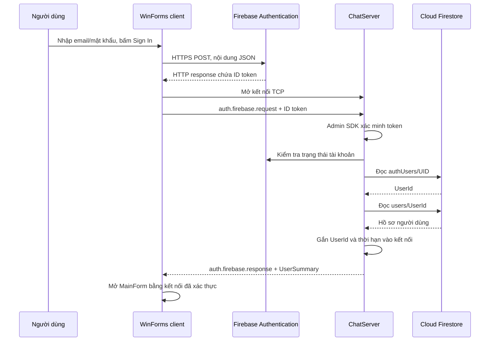

# Giải thích source code ChatApp — xác thực Firebase và giao tiếp TCP

Tài liệu chuyển từ phần giải thích trong session ngày 07/11/2026, lưu ngày 09/11/2026 để đọc lại và chuẩn bị báo cáo đồ án.

- Mốc Git khi lưu: `8b21e90` — `feat: authen login firebase`.
- Nội dung giải thích dựa trên source đã đọc; không phải báo cáo kiểm thử toàn bộ ứng dụng.
- Lượt lưu tài liệu không sửa source, không chạy đăng nhập Firebase thực tế.
- Các JSON, UID, UserId và RequestId bên dưới chỉ là ví dụ minh họa.
- Nếu source thay đổi sau mốc này, cần đọc lại code trước khi áp dụng nhận xét về trạng thái triển khai.

## Mục lục

1. [Chỉnh lại cách hiểu ban đầu](#1-chỉnh-lại-cách-hiểu-ban-đầu)
2. [Kiến trúc và ba project](#2-kiến-trúc-và-ba-project)
3. [Khởi động server](#3-khởi-động-server)
4. [Khởi động client và sự kiện Sign In](#4-khởi-động-client-và-sự-kiện-sign-in)
5. [HTTPS tới Firebase Authentication](#5-https-tới-firebase-authentication)
6. [Đọc HTTP response và lấy ID token](#6-đọc-http-response-và-lấy-id-token)
7. [Ba lớp giao tiếp TCP phía client](#7-ba-lớp-giao-tiếp-tcp-phía-client)
8. [RequestAsync và TaskCompletionSource](#8-requestasync-và-taskcompletionsource)
9. [PacketIO và cách đóng khung dữ liệu TCP](#9-packetio-và-cách-đóng-khung-dữ-liệu-tcp)
10. [Server nhận và phân loại packet](#10-server-nhận-và-phân-loại-packet)
11. [Xác minh token và lấy Firebase UID](#11-xác-minh-token-và-lấy-firebase-uid)
12. [Tra Firestore và gắn tài khoản vào kết nối](#12-tra-firestore-và-gắn-tài-khoản-vào-kết-nối)
13. [Response quay về LoginForm](#13-response-quay-về-loginform)
14. [Mở MainForm và quản lý vòng đời kết nối](#14-mở-mainform-và-quản-lý-vòng-đời-kết-nối)
15. [Luồng đăng ký và hoàn tất hồ sơ](#15-luồng-đăng-ký-và-hoàn-tất-hồ-sơ)
16. [Các phần giao diện còn lại](#16-các-phần-giao-diện-còn-lại)
17. [Các hàm Database về tin nhắn và lịch sử](#17-các-hàm-database-về-tin-nhắn-và-lịch-sử)
18. [Contracts, Models và JSON Schema](#18-contracts-models-và-json-schema)
19. [Exception đi từ đâu tới giao diện](#19-exception-đi-từ-đâu-tới-giao-diện)
20. [Những lỗi đã gặp trong session](#20-những-lỗi-đã-gặp-trong-session)
21. [Phạm vi hiện tại và những điểm còn cần chỉnh](#21-phạm-vi-hiện-tại-và-những-điểm-còn-cần-chỉnh)
22. [Cách trình bày báo cáo và đặt breakpoint](#22-cách-trình-bày-báo-cáo-và-đặt-breakpoint)

## 1. Chỉnh lại cách hiểu ban đầu

Luồng tổng quát đã hiểu đúng: client đăng nhập Firebase, nhận token, gửi token tới ChatServer, rồi server tra hồ sơ Firestore.

Cần phân biệt ba điểm:

1. Email/mật khẩu được kiểm tra bởi **Firebase Authentication**. Code đăng nhập không lấy mật khẩu từ collection `users` trong Firestore để so sánh.
2. `JsonDocument.Parse(body)` là **phân tích chuỗi JSON**, không phải ép kiểu chuỗi thành một đối tượng có sẵn.
3. Server chỉ tin Firebase UID **sau khi xác minh ID token thành công**. Nhận một chuỗi token qua TCP chưa đủ để biết người gửi là ai.

Firebase Authentication và Cloud Firestore có nhiệm vụ riêng. Có tài khoản Authentication không tự động đồng nghĩa đã có hồ sơ ChatApp trong Firestore.

## 2. Kiến trúc và ba project

| Thành phần | Nhiệm vụ |
|---|---|
| WinForms client | Nhận thao tác, gọi Firebase, giao tiếp TCP, hiển thị kết quả |
| Firebase Authentication | Quản lý tài khoản đăng nhập và cấp ID token |
| ChatServer do nhóm viết | Xác minh token, quản lý kết nối/phiên và xử lý request |
| Cloud Firestore | Lưu hồ sơ và dữ liệu ứng dụng |



Nếu trình đọc Markdown không hỗ trợ Mermaid, đọc luồng tương đương:

```text
WinForms → Firebase Authentication → ID token
WinForms → TCP ChatServer → xác minh token → UID
ChatServer → Firestore → UserId → hồ sơ
ChatServer → response → WinForms → MainForm
```

| Project | Nội dung |
|---|---|
| `ChatApp.Client` | WinForms, HTTP client, TCP client |
| `ChatApp.Server` | Console server, Firebase Admin SDK, truy cập Firestore |
| `ChatApp.Shared` | Packet, đọc/ghi packet và các kiểu dữ liệu dùng chung |

`Shared` là thư viện được hai project tham chiếu, không phải một chương trình server thứ ba. Các file `.csproj` khai báo framework, thư viện và project tham chiếu; `.slnx` tập hợp các project trong solution.

## 3. Khởi động server

Đọc [Program.cs phía server](../ChatApp.Server/Program.cs).

Thứ tự chạy:

1. Tạo `CancellationTokenSource`.
2. Đăng ký Ctrl+C để yêu cầu dừng.
3. Đọc `FIREBASE_PROJECT_ID`.
4. Tạo `Database`.
5. Gọi `CheckConnectionAsync`.
6. Khởi tạo Firebase Admin SDK.
7. Tạo `ChatServer` và gọi `Run(5000, ...)`.

`CancellationToken` là tín hiệu hủy công việc. Nó khác ID token dùng để xác thực người dùng.

Trong [Database.cs](../ChatApp.Server/Database.cs):

```csharp
_db = FirestoreDb.Create(projectId);
```

`_db` giữ đối tượng dùng để truy cập Firestore. Lệnh này không tạo database mới mỗi lần server chạy. Project ID chọn project, còn quyền truy cập sử dụng credentials mặc định.

`CheckConnectionAsync` tham chiếu tới:

```text
diagnostics/server-connection
```

`DocumentReference` chỉ là tham chiếu tới vị trí document. `SetAsync` mới thực sự ghi `CheckedAt` và `Application`. `GetSnapshotAsync` đọc lại dữ liệu; snapshot là bản dữ liệu tại thời điểm đọc, không phải ảnh chụp màn hình.

Nếu ghi/đọc thành công và document tồn tại, hàm kết thúc bình thường; Program mới in “Đã đọc/ghi Firestore thành công”.

Tiếp theo:

```csharp
FirebaseApp.Create(new AppOptions
{
    Credential = GoogleCredential.GetApplicationDefault(),
    ProjectId = projectId
});
```

Đây là khởi tạo cấu hình Admin SDK trong tiến trình server để sử dụng `FirebaseAuth.DefaultInstance`. Nó không tạo ứng dụng mới trên Firebase Console. Firestore đã được khởi tạo riêng trước đó.

Trong cấu hình đã dùng, credentials mặc định lấy thông tin từ file service account nằm ngoài repository, qua `GOOGLE_APPLICATION_CREDENTIALS`.

[ChatServer.Run](../ChatApp.Server/ChatServer.cs) tạo:

```csharp
TcpListener listener = new TcpListener(IPAddress.Loopback, port);
listener.Start();
```

`Loopback` là `127.0.0.1`, nên hiện server lắng nghe kết nối từ cùng máy.

Trong vòng lặp:

```csharp
TcpClient tcpClient = await listener.AcceptTcpClientAsync(ct);
ConnectedClient client = new ConnectedClient(tcpClient, _nextId++);
// Thêm client vào _clients.
_ = HandleClientAsync(client, ct);
```

`AcceptTcpClientAsync` chờ một kết nối mới. Sau khi tạo đối tượng đại diện cho kết nối, server bắt đầu xử lý nó rồi tiếp tục nhận client khác. `async` không đồng nghĩa mỗi client luôn được cấp một thread riêng.

[ConnectedClient.cs](../ChatApp.Server/ConnectedClient.cs) giữ:

| Thành viên | Ý nghĩa |
|---|---|
| `TcpClient` | Socket đã kết nối |
| `packetIO` | Đọc/ghi packet trên stream |
| `Id` | Số thứ tự kết nối để quản lý/log |
| `UserId` | Tài khoản ChatApp gắn với kết nối; ban đầu `null` |
| `SessionExpiresAt` | Hạn phiên; ban đầu `null` |

Log “Client ... đã kết nối” chỉ xác nhận mở TCP, chưa xác nhận đăng nhập.

`_clients` là danh sách các kết nối TCP. `_onlineUsers` là dictionary ánh xạ UserId của tài khoản đã xác thực sang kết nối đang sử dụng.

## 4. Khởi động client và sự kiện Sign In

[Program.cs phía client](../ChatApp.Client/Program.cs):

```csharp
ApplicationConfiguration.Initialize();
Application.Run(new LoginForm());
```

`Application.Run` chạy vòng xử lý sự kiện WinForms. Người dùng thao tác, WinForms gọi handler đã được đăng ký.

Constructor LoginForm gọi `InitializeComponent`. Phương thức trong [LoginForm.Designer.cs](../ChatApp.Client/Forms/LoginForm.Designer.cs) dựng control và nối sự kiện:

```csharp
btn_connect.Click += btn_connect_Click;
```

`LoginForm.cs` và `LoginForm.Designer.cs` là hai phần của cùng `partial class LoginForm`.

Trong [LoginForm.cs](../ChatApp.Client/Forms/LoginForm.cs), handler kiểm tra dữ liệu rỗng, tạo `ProtocolClient`, khóa nút và gọi:

```csharp
var firebase = new FirebaseAuthClient(
    Environment.GetEnvironmentVariable("FIREBASE_WEB_API_KEY") ?? "");

string idToken = await firebase.LoginAsync(
    txtEmail.Text.Trim(),
    txtPassword.Text);
```

Biến tên `username` ở đầu handler thực chất chứa email. `FirebaseAuthClient` là lớp do dự án định nghĩa để gọi REST API qua `HttpClient`; constructor chỉ kiểm tra và lưu API key.

`await` chờ công việc hoàn tất mà không cần giữ UI thread bận chờ trong lúc I/O chưa hoàn tất. Nó không tự động tạo thread mới cho mọi lời gọi.

## 5. HTTPS tới Firebase Authentication

Đọc [FirebaseAuthClient.cs](../ChatApp.Client/FirebaseAuthClient.cs).

```csharp
public Task<string> LoginAsync(
    string email,
    string password,
    CancellationToken ct = default)
    => SendAsync("signInWithPassword", email, password, ct);
```

`Task<string>` biểu diễn công việc sẽ trả về chuỗi khi hoàn tất. Ở đây kết quả là ID token.

`SendAsync` ghép action vào endpoint:

```text
https://identitytoolkit.googleapis.com/v1/accounts:signInWithPassword?key=...
```

Rồi gọi:

```csharp
using var response = await Http.PostAsJsonAsync(url, new
{
    email = email.Trim(),
    password,
    returnSecureToken = true
}, ct);
```

Thứ tự:

1. `new { ... }` tạo đối tượng C# chứa ba thuộc tính.
2. `PostAsJsonAsync` chuyển đối tượng thành JSON.
3. `HttpClient` gửi HTTP POST qua HTTPS.
4. Firebase Authentication kiểm tra thông tin đăng nhập của tài khoản trong project.
5. Firebase trả HTTP response.
6. `await` trả đối tượng phản hồi để gán vào `response`.

Body minh họa:

```json
{
  "email": "sinhvien@example.com",
  "password": "<mat-khau-nguoi-dung-nhap>",
  "returnSecureToken": true
}
```

Code ứng dụng không tự thực hiện thuật toán kiểm tra mật khẩu phía Firebase. Khi đăng nhập thành công, API trả ID token cùng refresh token và thông tin liên quan. Khi thất bại, API trả dữ liệu lỗi. Xem [Firebase Auth REST API](https://firebase.google.com/docs/reference/rest/auth).

Trong luồng hiện tại, mật khẩu không được gửi tới ChatServer. ChatServer nhận ID token ở bước sau. Hàm `HashSHA256` cũ trong form không được gọi ở đường này.

`HttpClient` được khai báo `static readonly` để dùng chung và có timeout 20 giây. API key xác định project cho lời gọi API; nó không phải mật khẩu người dùng hay ID token.

## 6. Đọc HTTP response và lấy ID token

```csharp
string body = await response.Content.ReadAsStringAsync(ct);
using var json = JsonDocument.Parse(body);
```

| Biến | Ý nghĩa |
|---|---|
| `response` | `HttpResponseMessage`, chứa status, headers và nội dung |
| `body` | Chuỗi nội dung phản hồi |
| `json` | `JsonDocument`, cấu trúc JSON đã phân tích |
| `token` | `JsonElement`, giá trị field lấy từ cấu trúc JSON |

Body thành công có dạng minh họa:

```json
{
  "idToken": "<firebase-id-token>",
  "localId": "uid-demo-abc",
  "email": "sinhvien@example.com",
  "refreshToken": "<refresh-token>",
  "expiresIn": "3600"
}
```

`JsonDocument.Parse` phân tích cú pháp JSON để truy cập field; chuỗi không hợp lệ có thể gây `JsonException`.

Code kiểm tra HTTP thành công bằng `response.IsSuccessStatusCode`. Nếu thất bại, nó đọc `error.message` và ném `FirebaseSignInException`.

Nếu thành công:

```csharp
if (!json.RootElement.TryGetProperty("idToken", out var token)
    || string.IsNullOrWhiteSpace(token.GetString()))
{
    throw new InvalidDataException("Firebase không trả về ID token.");
}

return token.GetString()!;
```

- `RootElement`: giá trị JSON ngoài cùng.
- `TryGetProperty`: tìm field theo tên.
- `out var token`: nhận giá trị tìm được.
- `GetString()`: lấy chuỗi trong giá trị JSON.
- `!`: khẳng định với bộ phân tích nullable rằng lập trình viên tin giá trị không null; không thực hiện xác minh token.

`return` trả chuỗi cho LoginForm trong cùng tiến trình client:

```csharp
string idToken = await firebase.LoginAsync(...);
```

Client mới chỉ nhận token từ Firebase; chưa gửi nó lên ChatServer. Code hiện chỉ lấy `idToken`, chưa dùng refresh token để tự làm mới phiên.

`using var response` và `using var json` bảo đảm giải phóng tài nguyên khi rời phạm vi sử dụng. Chuỗi token đã lấy ra vẫn được trả về bình thường.

## 7. Ba lớp giao tiếp TCP phía client

Sau khi có token:

```csharp
await protocol.ConnectAsync("127.0.0.1", 5000);
```

```text
LoginForm / MainForm / các panel
                 ↓
           ProtocolClient
                 ↓
          ClientConnection
                 ↓
              PacketIO
                 ↓
       NetworkStream → TCP
```

| Lớp | Trách nhiệm |
|---|---|
| [ProtocolClient](../ChatApp.Client/ProtocolClient.cs) | Quản lý request, response, event và chờ kết quả |
| [ClientConnection](../ChatApp.Client/ClientConnection.cs) | Mở/đóng socket và chuyển yêu cầu đọc/ghi xuống PacketIO |
| [PacketIO](../ChatApp.Shared/PacketIO.cs) | Chuyển Packet ↔ byte, đọc đủ và ghi tuần tự |

`ClientConnection.ConnectAsync`:

```csharp
_tcpClient = new TcpClient();
await _tcpClient.ConnectAsync(host, port);
_packetIO = new PacketIO(_tcpClient.GetStream());
```

`NetworkStream` dùng để đọc/ghi byte trên TCP. `Disconnect` dispose socket và xóa các tham chiếu kết nối.

`ProtocolClient.ConnectAsync` còn:

- Dùng `_connectGate` để tránh thao tác kết nối chồng nhau.
- Đóng kết nối cũ.
- Mở kết nối mới với thời gian chờ mặc định 10 giây.
- Lưu vào `_connection`.
- Bắt đầu `_ = ReceiveLoopAsync(connection)`.

Vòng nhận này chạy trong khi form tiếp tục các công việc khác. Form không mở thêm vòng đọc riêng trên cùng socket.

## 8. RequestAsync và TaskCompletionSource

Lời gọi đăng nhập:

```csharp
var result = await protocol.RequestAsync<AuthenticationResult>(
    "auth.firebase.request",
    new FirebaseLoginRequest(idToken, null, null));
```

| Thành phần | Ý nghĩa |
|---|---|
| `auth.firebase.request` | Tên thao tác gửi cho server |
| `FirebaseLoginRequest` | Dữ liệu gửi đi |
| `<AuthenticationResult>` | Kiểu C# muốn nhận về khi thành công |

`AuthenticationResult` chứa `UserSummary User`. Kiểu generic `T` hướng dẫn cách đọc phần `Data` của response; tên kiểu C# không được gửi trong packet.

### Tạo RequestId

```csharp
var id = Guid.NewGuid().ToString();
```

Ví dụ `e48d254c-143e-4e26-b221-19cc75a5bc7a` là ID của một yêu cầu, không phải ID tài khoản hoặc kết nối.

Client cần phân biệt nhiều request cùng đang chờ:

```text
Request A → friend.list.request
Request B → group.list.request
```

Response có `RequestId = A` được trả về lời gọi tải bạn bè; response B về lời gọi tải nhóm.

### Lưu mục chờ

```csharp
private sealed record Pending(
    ClientConnection Connection,
    string ResponseType,
    TaskCompletionSource<Packet> Completion);
```

Mỗi `Pending` nhớ kết nối, tên response mong đợi và đối tượng hoàn thành kết quả.

`_pending` là `ConcurrentDictionary<string, Pending>`, dùng RequestId làm key:

```text
_pending
  "e48d..." → chờ auth.firebase.response
  "7ab2..." → chờ friend.list.response
```

`ConcurrentDictionary` hỗ trợ thao tác từ các luồng thực thi khác nhau: bên gửi thêm mục chờ trong khi vòng nhận tìm phản hồi.

Code thêm mục chờ **trước khi gửi** để không bỏ lỡ phản hồi rất nhanh.

### TaskCompletionSource nối bên chờ với bên nhận

`RequestAsync` chờ:

```csharp
var response = await request.Completion.Task.WaitAsync(timeout.Token);
```

`ReceiveLoopAsync` nhận đúng packet sẽ gọi:

```csharp
request.Completion.TrySetResult(packet);
```

```text
RequestAsync: Tôi chờ Task này có kết quả.
ReceiveLoopAsync: Packet đã tới; tôi đặt packet làm kết quả của Task.
```

`TaskCompletionSource` không tự mở socket hay tạo thread đọc mạng. Nó cho phép một đoạn code hoàn thành `Task` mà đoạn code khác đang chờ.

`RunContinuationsAsynchronously` yêu cầu các phần tiếp tục chờ kết quả được lên lịch bất đồng bộ, tránh chạy nối trực tiếp vào thao tác đặt kết quả trong vòng nhận.

### Tạo packet và chờ kết quả

```csharp
var packet = new Packet
{
    Type = requestType,
    RequestId = id,
    Payload = JsonSerializer.SerializeToElement(payload)
};
```

JSON minh họa:

```json
{
  "Version": 1,
  "Type": "auth.firebase.request",
  "RequestId": "e48d254c-143e-4e26-b221-19cc75a5bc7a",
  "Payload": {
    "IdToken": "<firebase-id-token>",
    "Username": null,
    "DisplayName": null
  }
}
```

Hai trường hồ sơ là `null` vì đăng nhập thông thường không yêu cầu tạo hồ sơ mới.

Sau khi gửi, hàm chờ `Completion.Task`. Token timeout được liên kết với token hủy của bên gọi. Hết thời gian chờ mặc định 10 giây thì báo `TimeoutException`; `finally` xóa mục khỏi `_pending`.

Timeout chỉ có nghĩa client chưa nhận kết quả đúng hạn. Server có thể đã thực hiện thao tác, vì vậy không được suy ra rằng dữ liệu chắc chắn chưa lưu.

## 9. PacketIO và cách đóng khung dữ liệu TCP

TCP truyền một luồng byte. Không được giả định một lần `WriteAsync` tương ứng đúng một lần `ReadAsync`.

[PacketIO.cs](../ChatApp.Shared/PacketIO.cs) chuyển **toàn bộ Packet** thành JSON UTF-8:

```csharp
byte[] payload = JsonSerializer.SerializeToUtf8Bytes(packet);
```

Biến `payload` ở đây chứa toàn bộ JSON của Packet, khác với thuộc tính `Packet.Payload`.

Code thêm 4 byte đầu:

```csharp
byte[] header = new byte[4];
BinaryPrimitives.WriteInt32BigEndian(header, payload.Length);
```

```text
[4 byte biểu diễn độ dài N][N byte JSON của Packet]
```

Nếu JSON dài 300 byte thì header chứa số 300 theo thứ tự byte big-endian. Cả hai phía phải dùng cùng quy ước.

Phía nhận:

1. Đọc đủ 4 byte.
2. Giải mã độ dài N.
3. Kiểm tra giới hạn N.
4. Đọc đủ N byte.
5. `JsonSerializer.Deserialize<Packet>` để tạo đối tượng.

`ReadByte` thực chất lặp đến khi đầy buffer hoặc kết nối đóng, không chỉ đọc một byte. Nếu đóng kết nối ngay khi chờ header mới, hàm nhận trả `null`; nếu thiếu giữa packet, nó báo lỗi.

`MaxPacketSize = 1024 * 1024` giới hạn JSON của packet ở 1 MiB.

`_sendLock` giữ khóa cho cả header và body, tránh hai lần gửi xen kẽ:

```text
Sai: Header A → Header B → Body A → Body B
Đúng: Header A → Body A → Header B → Body B
```

Khóa này tuần tự hóa thao tác ghi của ứng dụng. Nó không thay đổi bản chất TCP thành giao thức giữ ranh giới thông điệp.

## 10. Server nhận và phân loại packet

`HandleClientAsync` gọi:

```csharp
Packet? packet = await sender.ReceivePacketAsync(ct);
```

Lời gọi đi qua `ConnectedClient` xuống `PacketIO`. `packet == null` nghĩa là kết nối kết thúc khi chờ packet mới.

Server kiểm tra:

- `Version == 1`.
- `Type` không rỗng.
- Nếu là request, `RequestId` có dạng GUID.
- Nếu đã đăng nhập, phiên còn hạn.

Sau đó:

```csharp
if (packet.Type == "auth.firebase.request")
{
    await HandleFirebaseLoginAsync(sender, packet, ct);
    continue;
}
```

Các packet của cùng client được xử lý lần lượt trong vòng lặp này vì có `await`. Những client khác có vòng xử lý riêng.

Sau nhánh xác thực, server yêu cầu kết nối có UserId, xử lý logout, trả `NOT_IMPLEMENTED` cho các request chưa hỗ trợ và xử lý riêng packet demo `chat`.

Các kiểm tra hiện tại được viết bằng C#. Chưa có bước đọc `protocol.schema.json` để validate packet lúc chạy.

## 11. Xác minh token và lấy Firebase UID

`HandleFirebaseLoginAsync` đọc Payload thành DTO:

```csharp
var request = JsonSerializer.Deserialize<FirebaseLoginRequest>(payload);
```

DTO trong [Authentication.cs](../ChatApp.Shared/Contracts/Authentication.cs):

```csharp
public sealed record FirebaseLoginRequest(
    string IdToken,
    string? Username,
    string? DisplayName);
```

Sau khi kiểm tra token không rỗng và không vượt giới hạn, server gọi:

```csharp
var verified = await FirebaseAuth.DefaultInstance.VerifyIdTokenAsync(
    request.IdToken,
    checkRevoked: true,
    cancellationToken: ct);
```

ID token mang thông tin định danh và chữ ký. Xác minh bao gồm các điều kiện như chữ ký, thời hạn, project và issuer phù hợp. Sau khi thành công mới sử dụng UID từ kết quả. Xem [Firebase: Verify ID tokens](https://firebase.google.com/docs/auth/admin/verify-id-tokens).

Code bật `checkRevoked: true` để kiểm tra thu hồi, rồi lấy tài khoản:

```csharp
var account = await FirebaseAuth.DefaultInstance.GetUserAsync(verified.Uid, ct);
if (account.Disabled)
    throw new InvalidOperationException("USER_DISABLED");
```

| Đối tượng | Nguồn |
|---|---|
| `verified` | Kết quả xác minh ID token |
| `account` | Tài khoản Firebase Authentication |
| `user` ở bước tiếp | Hồ sơ ChatApp trong Firestore |

`verified.Uid` là chuỗi Firebase UID, không phải ID token và không phải UserId kiểu `int`.

## 12. Tra Firestore và gắn tài khoản vào kết nối

Handler gọi:

```csharp
var user = await _database.GetUserByFirebaseUidAsync(verified.Uid, ct);
```

Trong [Database.cs](../ChatApp.Server/Database.cs):

```csharp
var mappingref = _db.Collection("authUsers")
    .Document(Uri.EscapeDataString(verifiedUid));
var mapping = await mappingref.GetSnapshotAsync(ct);
```

Ví dụ:

```text
authUsers/uid-demo-abc
    UserId: 7
```

Đọc `UserId`, rồi `GetUserAsync(7)` đọc:

```text
users/7
    Id: 7
    FirebaseUid: "uid-demo-abc"
    Username: "long"
    DisplayName: "Long"
    CreatedAt: ...
```

`ReadUser` chuyển document thành `UserSummary`. Nó đặt `IsOnline = false` trong bản dữ liệu vừa đọc. Trạng thái online thực tế được quản lý trong bộ nhớ server.

Nếu chưa có mapping:

- Đăng nhập không kèm hồ sơ → `PROFILE_REQUIRED`.
- Đăng ký/hoàn tất hồ sơ có thông tin → `EnsureProfileAsync`.

Nếu đã có mapping nhưng thiếu document user, code báo dữ liệu không nhất quán.

Sau khi có hồ sơ, server tính thời hạn từ token và cập nhật:

```csharp
lock (_sessionlock)
{
    // Kiểm tra hạn token và tài khoản đã online ở nơi khác.
    client.UserId = user.Id;
    client.SessionExpiresAt = expiresAt;
    _onlineUsers.Add(user.Id, client);
}
```

Khóa bảo vệ thao tác kiểm tra/thêm online user để hai kết nối cạnh tranh không cùng vượt qua kiểm tra ở đoạn này.

| Ví dụ | Ý nghĩa |
|---|---|
| `client.Id = 2` | Số thứ tự kết nối |
| `verified.Uid = "uid-demo-abc"` | ID tài khoản Firebase |
| `client.UserId = 7` | ID tài khoản ChatApp |
| `RequestId = "e48d..."` | ID một yêu cầu |

Kết nối mới của cùng tài khoản có thể có `client.Id` mới, nhưng UserId giữ nguyên vì hồ sơ được lưu ở Firestore.

## 13. Response quay về LoginForm

Server tạo:

```csharp
result = new AuthenticationResult(user with { IsOnline = true });
```

`with` tạo bản sao record và thay `IsOnline`. Nó không tự ghi trạng thái này lên Firestore.

`ReplyAsync` tạo response:

```json
{
  "Version": 1,
  "Type": "auth.firebase.response",
  "RequestId": "e48d254c-143e-4e26-b221-19cc75a5bc7a",
  "Payload": {
    "Success": true,
    "Data": {
      "User": {
        "Id": 7,
        "Username": "long",
        "DisplayName": "Long",
        "IsOnline": true
      }
    },
    "Error": null
  }
}
```

Tên response được tạo bằng cách bỏ `.request` rồi thêm `.response`. RequestId được giữ nguyên.

`ReceiveLoopAsync` ở client nhận packet, tìm `_pending[RequestId]`, kiểm tra kết nối và tên response rồi gọi:

```csharp
request.Completion.TrySetResult(packet);
```

Lời chờ trong `RequestAsync` hoàn tất. `ReadReply<T>` phân tích `Success`, `Data`, `Error`. Nếu thành công:

```csharp
return reply.Data.Deserialize<T>(_json);
```

Với `T = AuthenticationResult`, LoginForm nhận được `result.User`.

Nếu thất bại, `ReadReply` ném `ProtocolRequestException`. Với `NOT_AUTHENTICATED`, nó còn đóng kết nối.

### Packet không có RequestId

Vòng nhận chuyển các packet này sang:

```csharp
EventReceived?.Invoke(packet);
```

Đây là đường thông báo chủ động từ server, như chat demo hoặc các event bạn bè/nhóm dự kiến. `EventReceived` là sự kiện C# trong client; nó được kích hoạt sau khi nhận packet mạng.

### Các phần quản lý còn lại của ProtocolClient

| Thành viên | Vai trò |
|---|---|
| `Close` | Đóng đúng kết nối, báo lỗi các request đang chờ, phát `Disconnected` |
| `Disconnect` | Chủ động ngắt kết nối hiện tại |
| `Dispose` | Đánh dấu đối tượng kết thúc sử dụng và ngắt kết nối |
| `SendLegacyChatAsync` | Gửi packet `chat`, không chờ response nghiệp vụ |
| `IsConnected` | Kiểm tra `_connection` có giá trị; không phải kiểm tra mạng tức thời |

`Interlocked.CompareExchange` trong `Close` cập nhật kết nối một cách nguyên tử, tránh vòng nhận cũ đóng nhầm kết nối mới hoặc đóng cùng phiên nhiều lần.

`ConfigureAwait(false)` cho phép phần tiếp tục không phụ thuộc UI context; không có nghĩa luôn tạo thread mới.

## 14. Mở MainForm và quản lý vòng đời kết nối

LoginForm gọi:

```csharp
using var main = new MainForm(protocol, result.User);
protocol = null;
Hide();
try { main.ShowDialog(); }
finally { if (!IsDisposed) Show(); }
```

- MainForm nhận đúng đối tượng protocol vừa xác thực.
- `protocol = null` xóa tham chiếu cục bộ của LoginForm; MainForm vẫn giữ đối tượng qua `_protocol`.
- LoginForm không dispose kết nối đã bàn giao; MainForm chịu trách nhiệm đóng nó.
- `Hide` ẩn LoginForm nhưng giữ vòng đời ứng dụng.
- Khi MainForm đóng, LoginForm được hiện lại.

Nếu mở socket mới cho MainForm, socket mới chưa có UserId ở server. Có hồ sơ trên UI không tự làm socket mới trở thành đã xác thực.

Trong [MainForm.cs](../ChatApp.Client/Forms/MainForm.cs):

- `_currentUser` giữ hồ sơ đang đăng nhập.
- `_protocol` là kết nối dùng chung.
- FriendsPanel và GroupChatPanel sử dụng cùng protocol.
- `OnPacket` nhận packet và chuyển cho phần giao diện phù hợp.
- `OnDisconnected` xóa session UI và cập nhật trạng thái.
- `OnUi` dùng `InvokeRequired`/`BeginInvoke` để cập nhật control từ UI thread.

`Shown` gọi `RefreshSessionAsync`; nếu có user và kết nối, nó tải bạn bè/nhóm bằng `Task.WhenAll`.

[MainForm.Designer.cs](../ChatApp.Client/Forms/MainForm.Designer.cs) gọi `DisposeConnection` khi dispose. Hàm tháo event handler và dispose protocol.

Nút Demo mở MainForm không có user. Với auth guard hiện tại, mở TCP từ đường này không tự bỏ qua đăng nhập phía server.

## 15. Luồng đăng ký và hoàn tất hồ sơ

Đọc [RegisterForm.cs](../ChatApp.Client/Forms/RegisterForm.cs).

```csharp
string idToken = chkExistingAccount.Checked
    ? await firebase.LoginAsync(...)
    : await firebase.RegisterAsync(...);
```

- Chưa có tài khoản → gọi action `signUp`.
- Đã có tài khoản → đăng nhập để lấy token và hoàn tất hồ sơ.

Sau khi có token:

```csharp
chkExistingAccount.Checked = true;
```

Request tới ChatServer mang token, username và display name, khác với login thông thường gửi hai field hồ sơ là `null`.

### EnsureProfileAsync

1. Chuẩn hóa username về chữ thường, bỏ khoảng trắng đầu/cuối.
2. Kiểm tra username và display name.
3. Đọc mapping `authUsers/{uid}`.
4. Nếu đã có hồ sơ, trả hồ sơ cũ.
5. Nếu chưa có, kiểm tra `usernames/{username}`.
6. Đọc counter để cấp ID mới.
7. Ghi các document trong transaction.

| Document minh họa | Dữ liệu chính |
|---|---|
| `counters/users` | `LastId = 7` |
| `users/7` | Hồ sơ và Firebase UID |
| `authUsers/uid-demo-abc` | `UserId = 7` |
| `usernames/long` | `UserId = 7` |

Transaction giúp các ghi Firestore được áp dụng cùng nhau. Callback có thể được chạy lại nếu có thay đổi cạnh tranh, nên không gửi TCP hoặc hiện thông báo trong callback. Xem [Firestore transactions](https://firebase.google.com/docs/firestore/manage-data/transactions).

Transaction này không bao gồm `signUp` trước đó. Firebase Authentication có thể đã tạo tài khoản trong khi Firestore chưa có hồ sơ do username trùng hoặc lỗi kết nối.

Nếu UID đã có hồ sơ, code trả hồ sơ cũ, không đổi username theo input mới. Khi thử username trùng cần hiểu đang thử tạo hồ sơ mới hay đang đọc lại hồ sơ đã có.

### Logout sau khi đăng ký

RegisterForm gửi `auth.logout.request`. Bản source hiện tại đã có đúng nhánh server:

```csharp
ReleaseSession(sender);
await ReplyAsync(...);
break;
```

Server bỏ user khỏi `_onlineUsers`, trả response rồi đóng socket. RegisterForm thông báo hoàn tất và đóng; sự kiện `FormClosed` khiến LoginForm hiện lại.

Logout này giải phóng phiên TCP. Code không thu hồi toàn bộ Firebase token của tài khoản.

## 16. Các phần giao diện còn lại

| File/lớp | Công việc phía client |
|---|---|
| [FriendsPanel](../ChatApp.Client/Controls/FriendsPanel.cs) | Bạn bè, lời mời, tìm người và gửi request thay đổi quan hệ |
| [GroupChatPanel](../ChatApp.Client/Controls/GroupChatPanel.cs) | Danh sách nhóm, chọn nhóm, lịch sử, gửi tin nhóm và event |
| [CreateGroupDialog](../ChatApp.Client/Forms/CreateGroupDialog.cs) | Nhập tên, chọn tối đa 19 bạn để tạo nhóm cùng chủ nhóm |
| `GroupUiData` trong CreateGroupDialog.cs | Tải danh sách bạn bè đã chấp nhận |
| [GroupMembersDialog](../ChatApp.Client/Forms/GroupMembersDialog.cs) | Xem thành viên và UI quản lý dành cho chủ nhóm |
| [MessageTimeline](../ChatApp.Client/Controls/MessageTimeline.cs) | Hiển thị tin nhắn, tên, thời gian và cuộn |
| [UiTheme](../ChatApp.Client/Controls/UiTheme.cs) | Màu sắc và control dùng chung |
| [Resources.Designer.cs](../ChatApp.Client/Properties/Resources.Designer.cs) | Mã truy cập tài nguyên do công cụ sinh |

### FriendsPanel

- `SetSession`: thay tài khoản, hủy công việc cũ và xóa dữ liệu cũ.
- `RefreshAsync`/`ReadFriendsAsync`: tải từng trang bạn bè/lời mời.
- `SearchAsync`: tìm người.
- `AddAsync`, `RespondAsync`, `RemoveAsync`: gửi request thay đổi quan hệ.
- `HandleEvent`: nhận thay đổi quan hệ hoặc online/offline.
- `RenderLists`, `UpdateActions`: vẽ danh sách, bật/tắt nút.

`_sessionVersion` giúp bỏ qua kết quả của phiên cũ. Ví dụ request của tài khoản A hoàn tất sau khi chuyển sang tài khoản B thì không được hiển thị dữ liệu A lên phiên B.

### GroupChatPanel

Ngoài phiên, còn phải quản lý nhóm đang chọn. `_selectionVersion` và token hủy riêng giúp kết quả lịch sử nhóm A không ghi đè màn hình sau khi đã chọn nhóm B.

Các dictionary giữ nhóm theo ID, tin nhắn theo ID, tên thành viên và bản nháp theo nhóm. Dùng ID để hợp nhất tin nhắn giúp tránh trùng khi cùng tin xuất hiện trong response và event.

Các cờ `_sending`, `_historyBusy`, `_dialogOpen` kiểm soát thao tác chồng nhau. Nếu timeout khi ghi dữ liệu, giao diện yêu cầu đồng bộ để xác định kết quả trước khi thử lại.

### Phần vẽ giao diện

`MessageTimeline` chỉ nhận `MessageSummary` để vẽ, không tự gọi server. Nó dùng các control cho nội dung, giữ vị trí cuộn khi tải thêm và căn tin của mình khác tin người khác.

`UiTheme.cs` chứa `RoundedButton`, `ContactList`, `RoundedPanel`, `PageTabs`, tùy biến cách vẽ control. Chúng không xác thực người dùng hoặc truy cập database.

File `.Designer.cs` chủ yếu dựng giao diện và nối event. Những handler rỗng hiện không thực hiện nghiệp vụ.

Các phần bạn bè/nhóm đã có code client không đồng nghĩa server đã triển khai đầy đủ. Xem mục 21.

## 17. Các hàm Database về tin nhắn và lịch sử

| Hàm | Ý nghĩa |
|---|---|
| `Key(id)` | Chuyển ID số thành document ID dạng chuỗi |
| `Pair(a, b)` | Tạo khóa cặp ổn định; `Pair(7,2)` thành `2_7` |
| `User(id)` | Tham chiếu `users/{id}` |
| `ReadUser` | Document → UserSummary |
| `ReadMessage` | Document → MessageSummary |

`SendMessageAsync` đã có code kiểm tra một trong hai đích người nhận/nhóm, kiểm tra nội dung, quan hệ bạn bè hoặc thành viên nhóm, cấp ID và ghi message trong transaction. Kết quả trả về gồm message và danh sách người nhận dự kiến.

Hàm này không tự gửi TCP. Handler cần gọi nó rồi phát tin; hiện phần nối đó chưa có.

`GetHistoryAsync` xác định `ConversationKey`, truy vấn theo ID giảm dần, dùng `BeforeId` để tải tin cũ hơn. Lấy `limit + 1` để biết còn trang tiếp, rồi trả các tin và `NextBeforeId`. Hiện chưa có handler `chat.history.request` gọi nó.

### Chat demo khác luồng lưu tin nhắn

Packet `chat` hiện chạy:

```text
Client gửi chuỗi
    → server kiểm tra phiên
    → tạo chuỗi trả lời
    → gửi tới các client đã xác thực khác
```

Nó không gọi `SendMessageAsync`, nên không lưu nội dung vào Firestore.

Khi client tự thêm dòng “Bạn: ...” sau `SendLegacyChatAsync`, đó chưa phải xác nhận server đã lưu hoặc mọi người nhận đã nhận tin.

## 18. Contracts, Models và JSON Schema

[Authentication.cs](../ChatApp.Shared/Contracts/Authentication.cs) và [FriendsAndGroups.cs](../ChatApp.Shared/Contracts/FriendsAndGroups.cs) chứa các DTO truyền nhận: `FirebaseLoginRequest`, `AuthenticationResult`, `EmptyResult`, `UserSummary`, `FriendEntry`, `GroupSummary`, `MessageSummary` và các kiểu kết quả/phân trang.

Ví dụ:

```csharp
public sealed record PageResult<T>(
    IReadOnlyList<T> Items,
    int? NextAfterId);
```

`T` cho phép dùng cùng cấu trúc cho nhiều loại danh sách. `int?` có thể là số hoặc `null`; con trỏ `null` được dùng để báo hết trang.

Trong `Models` còn [UserData](../ChatApp.Shared/Models/UserData.cs), [Friend](../ChatApp.Shared/Models/Friend.cs), [Group](../ChatApp.Shared/Models/Group.cs), [Message](../ChatApp.Shared/Models/Message.cs). Chúng chưa phải các kiểu dữ liệu chính được dùng trong đường xác thực hiện tại.

`UserData.PasswordHash` và `HashSHA256` còn trong source nhưng không tham gia luồng Firebase. Không báo cáo rằng luồng mới băm bằng hàm này rồi lưu mật khẩu vào Firestore.

### Vì sao type chưa có trong schema vẫn chạy?

[protocol.schema.json](protocol.schema.json) mô tả cấu trúc và danh sách type hợp lệ, nhưng hiện không được client/server đọc để validate packet lúc chạy.

- `Packet.Type` là `string`.
- `RequestAsync` kiểm tra hậu tố `.request`, không tra enum trong schema.
- `PacketIO` deserialize theo lớp `Packet`, không áp dụng JSON Schema.
- Server có nhánh C# xử lý `auth.firebase.request` nên xử lý được.

Nếu đưa packet đó vào validator dùng schema hiện tại thì nó không hợp lệ vì type chưa có trong enum. Ngược lại, chỉ thêm type vào schema không tự tạo handler.

Cần đồng bộ [protocol.md](protocol.md), schema và [protocol.examples.jsonl](protocol.examples.jsonl) với DTO/request/response/mã lỗi Firebase. Hướng dẫn [xác thực giữa kỳ](xac-thuc-firebase-giua-ky.vi.md) đã đề xuất thay đổi này; không viết lại ProtocolClient chỉ để thêm tên request.

## 19. Exception đi từ đâu tới giao diện

| Nguồn | Đường xử lý |
|---|---|
| Firebase trả lỗi HTTP | FirebaseAuthClient đọc mã → FirebaseSignInException → form bắt → AuthMessages dịch |
| ChatServer trả lỗi nghiệp vụ | Server bắt exception → JSON lỗi → ProtocolRequestException ở client → form/panel bắt |

Ví dụ sai mật khẩu:

```text
Firebase trả INVALID_LOGIN_CREDENTIALS
    → FirebaseSignInException
    → catch trong LoginForm
    → FirebaseErrorMessage(...)
    → “Email hoặc mật khẩu không đúng.”
```

Câu tiếng Việt được định nghĩa trong [AuthMessages.cs](../ChatApp.Client/AuthMessages.cs), không phải C# tự tạo.

Ví dụ username trùng:

```text
Database ném InvalidOperationException("USERNAME_TAKEN")
    → ChatServer bắt và tạo response lỗi
    → JSON đi qua TCP
    → ProtocolClient tạo ProtocolRequestException
    → RegisterForm hiện ex.Message
```

Exception server không tự đi qua TCP. Server gửi dữ liệu JSON; client tạo exception riêng từ dữ liệu đó.

`throw` không tự hiện hộp thoại. `MessageBox.Show` hoặc gán label trong `catch` mới hiển thị thông báo.

`catch` được xét theo thứ tự và theo điều kiện `when` nếu có. Sau khi bắt lỗi, code không tự quay lại dòng lỗi để tiếp tục phần còn lại trong `try`.

`finally` dọn dẹp: khôi phục nút, bỏ request khỏi `_pending`, trả khóa hoặc giải phóng tài nguyên.

## 20. Những lỗi đã gặp trong session

### Biến môi trường API key

Đã gặp cả hai tình huống:

- Chưa có giá trị trong tiến trình chạy client.
- LoginForm từng đọc sai tên `FIREBASE_WEB_APIKEY`, thiếu dấu `_` giữa `API` và `KEY`.

Tên đúng:

```text
FIREBASE_WEB_API_KEY
```

Web API key khác Project ID. Các cấu hình:

| Biến | Giá trị | Phía dùng |
|---|---|---|
| `FIREBASE_WEB_API_KEY` | Web API key cùng Firebase project | Client |
| `FIREBASE_PROJECT_ID` | Project ID | Server |
| `GOOGLE_APPLICATION_CREDENTIALS` | Đường dẫn service-account JSON | Server |

Để terminal hiện tại nhận giá trị đã lưu ở User:

```powershell
$env:FIREBASE_WEB_API_KEY = [Environment]::GetEnvironmentVariable(
    "FIREBASE_WEB_API_KEY",
    "User"
)

[string]::IsNullOrWhiteSpace($env:FIREBASE_WEB_API_KEY)

dotnet run --project .\ChatApp.Client\ChatApp.Client.csproj
```

Kết quả kiểm tra phải là `False`. Lệnh đọc môi trường một tham số của C# đọc môi trường tiến trình hiện tại. Nạp vào terminal rồi chạy client từ chính terminal đó giúp tiến trình con nhận giá trị.

Không cần chép API key, token hoặc nội dung credentials vào báo cáo hay handoff.

### Đã lưu hồ sơ nhưng hiện NOT_IMPLEMENTED

RegisterForm từng gửi `auth.logout.request` trong khi server kiểm tra `auth.firebase.logout`.

Luồng khi đó:

```text
Tạo tài khoản → tạo hồ sơ thành công → gửi logout
    → server không nhận diện logout
    → system.error.response / NOT_IMPLEMENTED
    → ProtocolClient ném ProtocolRequestException
    → form hiện lỗi, bỏ qua thông báo thành công và Close()
```

Lỗi ở bước logout không rollback hồ sơ đã lưu. Source hiện đã sửa tên nhánh logout.

### Vì sao client ngắt kết nối khi lỗi?

`using var protocol` nằm trong `try` của RegisterForm. Khi rời phạm vi đó, kể cả do exception, `Dispose` đóng socket. Server đọc thấy kết nối kết thúc và in log.

Trong đường lỗi, việc dispose diễn ra khi rời `try`, trước `catch` hiển thị hộp thoại. Bấm OK không phải nguyên nhân trực tiếp đóng socket.

### Nút giữ chữ “Đang xử lý...”

Trước đây `finally` chỉ bật `Enabled`, chưa khôi phục `Text`. Source hiện đã thêm `btnRegister.Text = "Sign Up"`.

Điều kiện bảo vệ form vẫn cần chỉnh thành:

```csharp
finally
{
    if (!IsDisposed && !Disposing)
    {
        btnRegister.Enabled = true;
        btnRegister.Text = "Sign Up";
    }
}
```

Đây là đoạn hướng dẫn; lượt lưu tài liệu chưa sửa source.

## 21. Phạm vi hiện tại và những điểm còn cần chỉnh

| Nội dung | Trạng thái trong source |
|---|---|
| Gọi Firebase đăng ký/đăng nhập email và mật khẩu | Có |
| Server xác minh token, lấy UID | Có |
| Tạo/lấy hồ sơ Firestore | Có |
| Gắn UserId và thời hạn vào kết nối | Có |
| Ngăn tài khoản đăng nhập đồng thời ở hai kết nối | Có kiểm tra trong `_onlineUsers` |
| Logout và giải phóng phiên | Đã đúng tên request trong bản mới |
| Chat demo giữa client đã xác thực | Có đường broadcast |
| Bạn bè, nhóm, lịch sử, gửi tin lưu Firestore | Có client/một phần Database; thiếu handler chạy trọn luồng |
| JSON Schema validate packet lúc chạy | Chưa có |
| Tự làm mới ID token | Chưa có |
| Xác minh quyền sở hữu email bằng thư | Chưa có luồng triển khai |

MainForm vẫn tự tải bạn bè/nhóm. Vì thiếu handler, có thể thấy `NOT_IMPLEMENTED` dù đăng nhập thành công.

Phiên được kiểm tra hạn khi server xử lý packet tiếp theo. Không có timer đóng mọi socket ngay đúng thời điểm hết hạn; cũng chưa có luồng refresh token.

HTTPS tới Firebase không mã hóa chặng TCP riêng tới ChatServer. Chặng hiện tại dùng NetworkStream trên loopback, chưa có SslStream. Không mô tả toàn bộ giao tiếp của ứng dụng là HTTPS/TLS.

Các điểm còn cần chỉnh, quan sát từ source:

- RegisterForm: `!IsDisposed || Disposing` cần đổi thành `!IsDisposed && !Disposing`.
- RegisterForm: so sánh mật khẩu đã Trim nhưng gửi mật khẩu nguyên văn; cần thống nhất nguyên văn.
- Quy tắc username form và Database chưa đồng nhất: form chỉ chữ/số, server cho underscore và yêu cầu 3–20 ký tự; schema cũ mô tả 3–50.
- Switch lỗi server: `INVALID_TOKEN` đang gắn thông báo tài khoản vô hiệu hóa; thiếu nhánh riêng `USER_DISABLED`.
- `_clients.Remove(sender)` chưa dùng cùng khóa với thao tác quản lý danh sách khác.
- `ArgumentException("INVALID_REQUEST")` từ validate handler/Database chưa có nhánh chuyển mã tương ứng nên có thể rơi vào lỗi chung.
- Vòng đời tác vụ auth khi form đóng còn cần hoàn thiện.
- Schema và ví dụ giao thức chưa đồng bộ đầy đủ Firebase auth.

Các dòng comment “khung lớp/chưa triển khai” ở một số file đã cũ; đánh giá dựa trên code thực thi.

Đây không phải kết quả audit hoặc kiểm thử toàn diện. Những chức năng có code vẫn cần thử thực tế để xác nhận các trường hợp thành công, thất bại và cạnh tranh.

## 22. Cách trình bày báo cáo và đặt breakpoint

### Đoạn diễn giải kiến trúc tham khảo

> Ứng dụng của nhóm gồm client WinForms, server TCP và thư viện Shared. Client gửi email và mật khẩu qua HTTPS tới Firebase Authentication để lấy ID token. Sau đó client mở kết nối TCP tới server và gửi token trong packet auth.firebase.request.
>
> Server dùng Firebase Admin SDK xác minh token, lấy Firebase UID đã xác thực rồi tra mapping trong Firestore để tìm UserId của ChatApp. Khi có hồ sơ hợp lệ, server gắn UserId và thời hạn phiên vào kết nối, đồng thời trả thông tin người dùng cho client.
>
> Giao tiếp TCP sử dụng JSON UTF-8, có header 4 byte biểu diễn độ dài packet. ProtocolClient dùng một vòng nhận chung và RequestId để ghép mỗi phản hồi với yêu cầu tương ứng. MainForm tiếp tục sử dụng kết nối đã được xác thực.
>
> Phần hiện đã nối xuyên suốt tập trung vào xác thực và hồ sơ. Các chức năng bạn bè, nhóm và lịch sử đã có phần giao diện hoặc xử lý dữ liệu, nhưng còn cần bổ sung handler phía server.

Chỉ nói “đã kiểm thử thành công” với tình huống đã thực sự chạy; không suy ra toàn bộ chức năng hoàn thiện từ việc mở được MainForm.

### Thứ tự đặt breakpoint

| Thứ tự | Vị trí | Quan sát |
|---|---|---|
| 1 | LoginForm trước `firebase.LoginAsync` | Đường gọi đăng nhập |
| 2 | FirebaseAuthClient sau `PostAsJsonAsync` | HTTP status |
| 3 | Sau `JsonDocument.Parse` | Cấu trúc response |
| 4 | RequestAsync sau tạo `id` | RequestId, type và `_pending` |
| 5 | ChatServer tại nhánh `auth.firebase.request` | Packet server nhận |
| 6 | Sau `VerifyIdTokenAsync` | UID đã xác minh |
| 7 | GetUserByFirebaseUidAsync | Mapping và UserId |
| 8 | Sau gán `client.UserId` | Kết nối có danh tính và thời hạn |
| 9 | ReceiveLoopAsync tại `TrySetResult` | Response hoàn thành mục chờ nào |
| 10 | LoginForm sau `await RequestAsync` | `result.User`, bước mở MainForm |

Theo dõi một lượt đăng nhập qua các điểm này để thấy dữ liệu từ textbox tới Firebase, qua TCP tới server, rồi quay lại thành UserSummary. Khi chụp hình cho báo cáo, chọn dữ liệu trạng thái và cấu trúc phù hợp, không đưa mật khẩu hoặc token thật vào ảnh.

### Tài liệu liên quan

- [Hướng dẫn xác thực Firebase giữa kỳ](xac-thuc-firebase-giua-ky.vi.md).
- [Hướng dẫn tích hợp Firebase](tich-hop-firebase.vi.md).
- [Giao thức hiện có](protocol.md).
- [Firebase Auth REST API](https://firebase.google.com/docs/reference/rest/auth).
- [Firebase Admin: xác minh ID token](https://firebase.google.com/docs/auth/admin/verify-id-tokens).
- [Firestore transactions](https://firebase.google.com/docs/firestore/manage-data/transactions).
- [Firebase API keys](https://firebase.google.com/docs/projects/api-keys).
- [.NET Environment.GetEnvironmentVariable](https://learn.microsoft.com/en-us/dotnet/api/system.environment.getenvironmentvariable?view=net-10.0).
