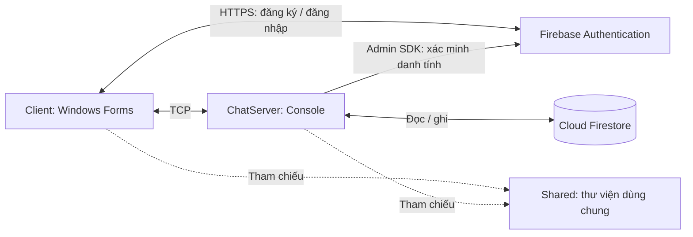

# Nội dung thuyết trình giữa kỳ NEXUS X — bản điều chỉnh

Đối chiếu source tại `Do_an`, HEAD `162240b`, ngày 12/11/2026. Dành cho bài trình bày 10–15 phút. Bản này thay dàn ý slide trong tài liệu `bao-cao-tien-do-giua-ky.vi.md`; giữ tài liệu cũ làm bản đánh giá trước khi cải thiện. Đây là nội dung dựng PPT và ghi chú thuyết trình, không phải file PowerPoint.

## Ghi chú chuẩn bị — không đưa nguyên phần này lên slide

- Đã đọc lại RegisterForm, LoginForm, MainForm, ChatServer, Database và cấu hình project. Build bằng `dotnet build ChatApp.Nhom1.slnx --no-restore` thành công, 0 warning, 0 error. Chưa chạy kiểm thử Firebase thực tế trong lần rà soát này.
- Đã có các sửa đổi: giữ nguyên mật khẩu khi so sánh; thống nhất username 3–20 ký tự; kiểm tra email trống và tên hiển thị; che mật khẩu; sửa mã/thông báo lỗi; khóa khi xóa client; chặn gửi khi chưa có người dùng; sửa điều kiện cập nhật RegisterForm khi dispose.
- Chưa thấy hoàn tất toàn bộ các mục 1–7: MainForm vẫn tự tải bạn bè/nhóm; server vẫn trả NOT_IMPLEMENTED cho các request này. HashSHA256 và trường `_connection` cũ vẫn còn trong form đăng ký; tài liệu protocol vẫn mô tả auth.login. Không lấy code SHA256 làm nội dung giới thiệu xác thực hiện tại.
- Giao diện và hàm database đã có không đồng nghĩa tính năng chạy hoàn chỉnh. Nội dung slide dùng “đã triển khai luồng” thay cho khẳng định đã nghiệm thu. Sau khi nhóm kiểm thử, có thể bổ sung kết quả thực tế.

## Mạch trình bày

**Nhóm muốn làm gì → tổ chức ứng dụng thế nào → dùng công nghệ nào → công nghệ hỗ trợ xác thực ra sao → người dùng đăng ký/đăng nhập thế nào → kết quả hiện tại → hạn chế → kế hoạch cuối kỳ.**

Không có slide riêng về Packet, byte header, RequestId hoặc mã nguồn. TCP được giới thiệu ở mức vai trò trong kiến trúc; chi tiết protocol chỉ dùng khi trả lời câu hỏi. Giữ cấu trúc bốn slide đầu mà nhóm đã chuẩn bị.

| Slide | Nội dung | Thời lượng gợi ý |
|---|---|---|
| 1 | Tiêu đề báo cáo | 20 giây |
| 2 | Phạm vi và mục tiêu hoàn thành | 40 giây |
| 3 | Kiến trúc ứng dụng | 60 giây |
| 4 | Công nghệ sử dụng | 60 giây |
| 5 | Vai trò của xác thực và lưu trữ dữ liệu | 60 giây |
| 6 | Quy trình đăng ký và đăng nhập | 75 giây |
| 7 | Kết quả hiện tại và minh họa ứng dụng | 3 phút, gồm demo |
| 8 | Hạn chế hiện tại | 50 giây |
| 9 | Kế hoạch phát triển cuối kỳ | 60 giây |
| 10 | Kết luận và trao đổi | 20 giây |

Tổng khoảng 12 phút 5 giây; còn khoảng trống cho chuyển màn hình và câu hỏi nếu có 15 phút. Nếu chỉ có 10 phút, rút demo xuống 2 phút và giảm lời giải thích ở slide 3–6; không cần thêm/bớt chủ đề kỹ thuật.

## Slide 1 — NEXUS X: Báo cáo tiến độ giữa kỳ

### Nội dung trên slide

Giữ slide đã làm: tên ứng dụng, tên học phần, lớp, giảng viên hướng dẫn, nhóm và thành viên. Có thể thêm dòng phụ: **Ứng dụng chat desktop theo mô hình client–server**.

### Lời nói gợi ý

“Kính chào thầy/cô và các bạn. Nhóm em xin trình bày tiến độ giữa kỳ của đồ án NEXUS X, một ứng dụng chat trên máy tính. Trong giai đoạn này, nhóm tập trung xây dựng kiến trúc nền tảng và triển khai chức năng đăng ký, đăng nhập.”

### Câu chuyển

“Trước hết, nhóm xin giới thiệu phạm vi sản phẩm và mục tiêu cụ thể của giai đoạn giữa kỳ.”

## Slide 2 — Phạm vi và mục tiêu hoàn thành

### Nội dung trên slide

- **Định hướng sản phẩm:** xây dựng ứng dụng chat desktop, hướng tới trao đổi tin nhắn cá nhân và theo nhóm.
- **Phạm vi triển khai:** giao diện người dùng, server xử lý kết nối và các dịch vụ xác thực, lưu trữ dữ liệu.
- **Mục tiêu giữa kỳ:** triển khai đăng ký tài khoản, tạo hồ sơ và đăng nhập bằng email/mật khẩu.
- **Yêu cầu của luồng xác thực:** kiểm tra dữ liệu nhập, thông báo lỗi và xác định người dùng trước khi sử dụng chức năng cần đăng nhập.
- **Nền tảng cho cuối kỳ:** tổ chức source để tiếp tục tích hợp bạn bè, nhóm và lịch sử trò chuyện.

### Lời nói gợi ý

“Sản phẩm cuối kỳ hướng tới chat cá nhân và chat nhóm. Tuy nhiên, ở mốc giữa kỳ, nhóm ưu tiên chức năng tài khoản theo yêu cầu của môn học. Người dùng cần đăng ký được, có hồ sơ trong ứng dụng và được server xác thực khi đăng nhập. Đây là nền tảng để sau này biết ai đang gửi tin và người đó được tham gia cuộc trò chuyện nào.”

### Câu chuyển

“Để đáp ứng các mục tiêu này và thuận tiện phát triển thêm chức năng, nhóm tổ chức ứng dụng theo kiến trúc sau.”

### Bố cục gợi ý

Hai khối: “Mục tiêu giữa kỳ” và “Định hướng cuối kỳ”. Dùng nhãn để phân biệt kế hoạch với tính năng hiện có, không dùng một danh sách khiến người xem tưởng tất cả đã hoàn thành.

## Slide 3 — Kiến trúc ứng dụng

### Nội dung trên slide

- **Mô hình client–server:** client nhận thao tác người dùng; server tiếp nhận kết nối và xử lý yêu cầu của ứng dụng.
- **ChatApp.Client:** ứng dụng Windows Forms, cung cấp màn hình đăng ký, đăng nhập và giao diện trò chuyện.
- **ChatApp.Server:** chương trình console, quản lý kết nối, xác minh danh tính và truy cập dữ liệu.
- **ChatApp.Shared:** thư viện chứa cấu trúc dữ liệu và quy ước trao đổi dùng chung cho client và server.
- **Dịch vụ bên ngoài:** Firebase Authentication phục vụ tài khoản; Cloud Firestore phục vụ lưu trữ dữ liệu.

### Sơ đồ để dựng lại bằng Shapes trong PowerPoint

Nét liền biểu diễn giao tiếp; nét đứt biểu diễn tham chiếu thư viện. Shared không nằm giữa đường truyền Client–Server. Sơ đồ thể hiện vai trò logic của Admin SDK, không mô tả chi tiết từng bước xác minh token hoặc truy vấn mạng nội bộ của SDK.

### Lời nói gợi ý

“Theo mô hình client–server, phần giao diện và phần xử lý phía server có trách nhiệm riêng. Client tương tác với người dùng, còn server quản lý kết nối và kiểm tra danh tính trước khi xử lý nghiệp vụ. Shared giúp hai phía sử dụng thống nhất cấu trúc dữ liệu; đây là thư viện dùng chung, không phải server thứ ba. Ngoài ra, client dùng Firebase để đăng nhập và server dùng Firestore để truy cập hồ sơ.”

### Câu chuyển

“Sau khi xác định vai trò của từng thành phần, nhóm lựa chọn các công nghệ tương ứng để hiện thực kiến trúc này.”

## Slide 4 — Công nghệ sử dụng

### Nội dung trên slide

| Công nghệ | Khái niệm và vai trò trong ứng dụng |
|---|---|
| **C# và .NET 10** | Ngôn ngữ và nền tảng xây dựng client, server cùng thư viện dùng chung. |
| **Windows Forms** | Công nghệ xây dựng giao diện desktop Windows bằng form và các control. |
| **TCP và JSON** | TCP phục vụ truyền dữ liệu giữa client–server; JSON là định dạng biểu diễn dữ liệu trao đổi. |
| **Firebase Authentication** | Dịch vụ quản lý tài khoản và xác thực đăng nhập; nhóm đang tích hợp email/mật khẩu. |
| **Cloud Firestore** | Cơ sở dữ liệu NoSQL lưu thông tin theo collection và document; hiện dùng trong luồng hồ sơ người dùng. |

### Lời nói gợi ý

“C# và .NET là nền tảng chung giúp nhóm xây dựng các thành phần bằng cùng một hệ công nghệ. WinForms phục vụ giao diện desktop. TCP cho phép client và server trao đổi dữ liệu, còn JSON quy định cách biểu diễn nội dung. Về dịch vụ dữ liệu, nhóm sử dụng Firebase Authentication cho tài khoản và Cloud Firestore cho hồ sơ. Những lựa chọn này phục vụ trực tiếp các thành phần trong sơ đồ vừa trình bày.”

### Câu chuyển

“Trong các công nghệ trên, Firebase Authentication và Firestore trực tiếp phục vụ mục tiêu giữa kỳ. Hai dịch vụ này có vai trò khác nhau như sau.”

### Bố cục gợi ý

Dùng bảng hai cột hoặc ba cụm “Nền tảng – Giao tiếp – Dịch vụ dữ liệu”. Không thêm slide định nghĩa riêng cho từng thuật ngữ. Có thể bỏ JSON khỏi lời nói nếu cần rút thời gian.

## Slide 5 — Vai trò của xác thực và lưu trữ dữ liệu

### Nội dung trên slide

**Firebase Authentication — xác định danh tính tài khoản**

- Xác thực là quá trình kiểm tra thông tin đăng nhập để xác định tài khoản người dùng.
- Ứng dụng sử dụng email và mật khẩu để đăng ký, đăng nhập với Firebase.
- Khi thành công, client nhận ID token — thông tin chứng thực mà server phải kiểm tra trước khi chấp nhận phiên.

**Cloud Firestore — lưu hồ sơ ứng dụng**

- Dữ liệu được tổ chức thành collection chứa các document, thay vì các bảng quan hệ như mô hình SQL.
- Hồ sơ lưu thông tin như mã người dùng, username, tên hiển thị và thời điểm tạo.
- Hồ sơ được liên kết với tài khoản Firebase; mật khẩu không được lưu trong hồ sơ Firestore của luồng hiện tại.

### Lời nói gợi ý

“Có thể hiểu Firebase Authentication giúp trả lời ‘người dùng đang đăng nhập bằng tài khoản nào’, còn Firestore lưu ‘người dùng đó có hồ sơ gì trong ứng dụng’. Sau khi Firebase chấp nhận thông tin đăng nhập, client nhận token để gửi cho server. Server vẫn phải kiểm tra token rồi mới chấp nhận danh tính. Như vậy, đăng nhập không chỉ là thao tác chuyển từ form này sang form khác.”

### Câu chuyển

“Khi kết hợp giao diện, server và hai dịch vụ này, thao tác đăng ký và đăng nhập của người dùng được thực hiện theo quy trình sau.”

### Bố cục gợi ý

Hai cột “Tài khoản xác thực” và “Hồ sơ ứng dụng”, nối bằng mũi tên “Liên kết người dùng”. Không đưa JWT payload, mã token thật hoặc các trường kỹ thuật dài lên slide.

## Slide 6 — Quy trình đăng ký và đăng nhập

### Nội dung trên slide

**Đăng ký tài khoản**

1. Người dùng nhập email, username, tên hiển thị và mật khẩu xác nhận.
2. Client kiểm tra dữ liệu và yêu cầu Firebase tạo tài khoản.
3. Server xác minh token, kiểm tra username và tạo hồ sơ trong Firestore.
4. Khi hoàn tất, ứng dụng thông báo thành công và quay về màn hình đăng nhập.

**Đăng nhập ứng dụng**

1. Người dùng nhập email và mật khẩu đã đăng ký.
2. Firebase kiểm tra thông tin đăng nhập và trả ID token khi hợp lệ.
3. Server xác minh token, tìm hồ sơ và gắn người dùng vào kết nối.
4. Client mở màn hình chính với thông tin của tài khoản đã được xác thực.

**Xử lý gián đoạn:** nếu đã tạo tài khoản nhưng chưa hoàn tất hồ sơ, người dùng có thể tiếp tục bằng chế độ “Hoàn tất hồ sơ”.

### Lời nói gợi ý

“Điểm khác nhau là đăng ký tạo tài khoản và hồ sơ mới, còn đăng nhập kiểm tra một tài khoản đã có để thiết lập phiên sử dụng. Trong cả hai luồng, server đều phải xác minh token. Nhóm cũng xử lý tình huống Firebase đã tạo tài khoản nhưng bước tạo hồ sơ chưa thành công, chẳng hạn do mất kết nối. Người dùng có thể hoàn tất hồ sơ bằng tài khoản đó thay vì đăng ký lại.”

### Câu chuyển

“Từ quy trình này, nhóm đã triển khai các thành phần sau và xin minh họa bằng ứng dụng hiện tại.”

### Bố cục gợi ý

Hai cột, mỗi cột bốn bước có số thứ tự. Dòng xử lý gián đoạn đặt trong hộp nhỏ bên dưới. Nếu slide quá chật, chuyển dòng đó sang lời nói, giữ nguyên hai quy trình chính.

## Slide 7 — Kết quả hiện tại và minh họa ứng dụng

### Nội dung trên slide

- **Đã triển khai luồng đăng ký/đăng nhập:** kết nối form với Firebase Authentication, server và hồ sơ Firestore.
- **Đã bổ sung kiểm tra đầu vào:** thông tin bắt buộc, quy tắc username, mật khẩu xác nhận và tên hiển thị.
- **Đã cải thiện phản hồi và giao diện:** che mật khẩu, thông báo lỗi phù hợp và kiểm tra trạng thái trước khi cho gửi chat.
- **Đã có xử lý phiên cơ bản:** xác minh danh tính trên server, chặn yêu cầu khi chưa đăng nhập và kiểm tra tài khoản đang online.
- **Nội dung minh họa:** đăng ký tài khoản mới → xem hồ sơ → đăng nhập sai → đăng nhập đúng.

### Lời nói gợi ý trước demo

“Đến thời điểm hiện tại, nhóm đã nối các thành phần của luồng xác thực và bổ sung những kiểm tra dữ liệu, thông báo lỗi cần thiết. Phần minh họa sẽ cho thấy cả trường hợp hợp lệ và trường hợp bị từ chối. Sau khi đăng nhập đúng, màn hình chính hiển thị thông tin người dùng mà server trả về.”

### Kịch bản demo, khoảng 2–2,5 phút

1. Cho thấy server đang chạy, không trình chiếu khóa cấu hình hay token.
2. Đăng ký bằng email thử nghiệm mới; chọn username chưa sử dụng, phù hợp quy tắc.
3. Chỉ nhanh tài khoản trong Firebase Authentication và hồ sơ tương ứng trong Firestore; có thể dùng ảnh đã chuẩn bị nếu chuyển trang tốn thời gian.
4. Đăng nhập sai mật khẩu để minh họa phản hồi lỗi.
5. Đăng nhập đúng và chỉ thông tin người dùng trên MainForm.

Nếu dùng ảnh/video thay demo trực tiếp thì ghi rõ. Chỉ bổ sung dòng “đã kiểm thử đạt” và số ca đạt khi nhóm đã chạy và ghi nhận thật. Build thành công không chứng minh mọi ca nghiệp vụ đều đạt.

### Câu chuyển

“Phần minh họa cho thấy luồng xác thực đã được triển khai. Tuy nhiên, để trở thành một ứng dụng chat hoàn chỉnh, phiên bản hiện tại vẫn còn các giới hạn sau.”

## Slide 8 — Hạn chế hiện tại

### Nội dung trên slide

- **Chức năng chat chưa hoàn thiện:** bạn bè, nhóm và lịch sử đã có một phần giao diện hoặc lớp dữ liệu, nhưng chưa được tích hợp đầy đủ với server.
- **Chat hiện tại chủ yếu là bản demo:** luồng chat chung đã có trong code nhưng chưa lưu lịch sử vào Firestore.
- **Phạm vi kết nối còn cục bộ:** server đang cấu hình chạy trên cùng máy; chưa hoàn thiện triển khai qua LAN và mã hóa đường truyền TCP.
- **Vòng đời phiên còn cơ bản:** chưa có tự động làm mới token và cần hoàn thiện trải nghiệm đăng xuất, kết nối lại khi mất mạng.
- **Phụ thuộc dịch vụ trực tuyến:** luồng Firebase hiện tại cần Internet; cần tiếp tục kiểm thử lỗi mạng và các tình huống sử dụng đồng thời.

### Lời nói gợi ý

“Nhóm hiện tập trung vào nền tảng và xác thực nên các chức năng chat nghiệp vụ chưa hoàn thiện. Giao diện bạn bè và nhóm đã có nhưng chưa thể xem là chức năng hoàn chỉnh khi server chưa xử lý đầy đủ. Ngoài ra, bản hiện tại đang cấu hình kết nối trên cùng máy. Các vấn đề triển khai nhiều máy, bảo vệ đường truyền và xử lý mất kết nối sẽ được đưa vào giai đoạn tiếp theo.”

### Câu chuyển

“Từ những hạn chế này, nhóm xác định các công việc ưu tiên cho giai đoạn cuối kỳ như sau.”

## Slide 9 — Kế hoạch phát triển cuối kỳ

### Nội dung trên slide

| Giai đoạn | Nội dung dự kiến | Kết quả hướng tới |
|---|---|---|
| **1. Hoàn thiện tài khoản** | Rà soát xác thực, đăng xuất, xử lý phiên hết hạn và lỗi kết nối. | Đăng nhập và kết thúc phiên rõ ràng, ổn định. |
| **2. Bạn bè và chat cá nhân** | Tìm người dùng, gửi/chấp nhận lời mời kết bạn, nhắn tin trực tiếp. | Hai người dùng trao đổi tin đúng cuộc hội thoại. |
| **3. Nhóm và lịch sử** | Tạo nhóm, quản lý thành viên, gửi tin nhóm và lưu/tải lịch sử. | Cuộc trò chuyện được lưu và truy cập đúng quyền. |
| **4. Tích hợp và kiểm thử** | Cấu hình kết nối nhiều máy, bổ sung TLS và kiểm thử các luồng chính. | Có bản demo cuối kỳ chạy đầy đủ theo phạm vi đã chọn. |

### Lời nói gợi ý

“Nhóm sẽ triển khai theo từng luồng sử dụng hoàn chỉnh. Trước hết là ổn định tài khoản, sau đó nối chức năng bạn bè và chat cá nhân với server và database. Tiếp theo là nhóm và lịch sử trò chuyện. Cuối cùng, nhóm tích hợp, bổ sung bảo vệ đường truyền và kiểm thử nhiều máy. Mục tiêu là các chức năng chạy xuyên suốt từ giao diện đến dữ liệu.”

### Câu chuyển

“Các công việc này sẽ tiếp tục sử dụng kiến trúc và nền tảng xác thực đã xây dựng ở giữa kỳ.”

### Ghi chú chuẩn bị

- Đây là kế hoạch đề xuất dựa trên source hiện có. Nhóm cần xác nhận lại phạm vi cuối kỳ đã đăng ký với giảng viên.
- Điền người phụ trách và mốc tuần theo lịch thật vào ghi chú hoặc slide phụ; không tự gán tên hoặc ngày khi chưa thống nhất.
- Bổ sung TLS trước khi đưa token qua LAN/Internet. Không hiểu thứ tự bảng là có thể chạy thử LAN không mã hóa trước rồi mới bổ sung TLS.
- Lưu và tải lịch sử chat cá nhân có thể triển khai ngay trong giai đoạn 2; giai đoạn 3 mở rộng cho nhóm.
- Quên mật khẩu/xác minh email là phần có thể bổ sung nếu phù hợp phạm vi và thời gian. Chưa nên hứa gọi video, gửi file hay nhiều phương thức đăng nhập khi luồng chat chính chưa hoàn thiện.

## Slide 10 — Kết luận và trao đổi

### Nội dung trên slide

- **Đã xây dựng nền tảng:** tổ chức Client–Server–Shared và tích hợp dịch vụ xác thực, lưu trữ.
- **Trọng tâm giữa kỳ:** triển khai luồng đăng ký, đăng nhập, hồ sơ và các kiểm tra liên quan.
- **Hướng tới cuối kỳ:** hoàn thiện chức năng chat, lưu lịch sử và kiểm thử tích hợp.

**Nhóm xin cảm ơn thầy/cô và các bạn.**

### Lời nói gợi ý

“Qua giai đoạn giữa kỳ, nhóm đã xây dựng nền tảng kiến trúc và triển khai luồng xác thực để tiếp tục phát triển các chức năng chat. Trong giai đoạn tiếp theo, nhóm sẽ tập trung tích hợp nghiệp vụ và kiểm thử để hoàn thiện sản phẩm. Nhóm xin cảm ơn và mong nhận được góp ý của thầy/cô.”

## Thuật ngữ để tập nói — không cần thêm slide

| Thuật ngữ | Cách giải thích ngắn |
|---|---|
| Client–server | Mô hình phân chia phần tương tác người dùng và phần tiếp nhận, xử lý yêu cầu. |
| WinForms | Công nghệ tạo giao diện ứng dụng desktop trên Windows. |
| Console application | Chương trình chạy với giao diện dòng lệnh; trong đồ án dùng để chạy server và xem log. |
| Shared | Thư viện mã dùng chung, không phải một server hoặc một tầng mạng riêng. |
| TCP | Giao thức truyền dữ liệu qua kết nối; trong đồ án dùng giữa client và ChatServer. |
| JSON | Định dạng biểu diễn dữ liệu trao đổi; không phải giao thức kết nối mạng. |
| Authentication | Xác thực tài khoản: kiểm tra danh tính khi đăng nhập. |
| ID token | Thông tin chứng thực nhận sau đăng nhập, cần được server xác minh. |
| Firestore | Cơ sở dữ liệu NoSQL tổ chức dữ liệu thành collection và document. |
| TLS | Cơ chế bảo vệ đường truyền, cần bổ sung cho kết nối TCP khi triển khai qua mạng. |

## Ba câu hỏi dễ gặp

**Firebase đã làm xác thực, nhóm tự làm những gì?**

Nhóm tự xây giao diện desktop, server TCP, cách trao đổi dữ liệu, xử lý phiên, liên kết hồ sơ và các chức năng chat. Firebase cung cấp dịch vụ tài khoản và dữ liệu hỗ trợ các thành phần đó.

**Vì sao cần cả Authentication và Firestore?**

Authentication xử lý tài khoản đăng nhập; Firestore lưu hồ sơ và dữ liệu nghiệp vụ. Hai phần liên kết với nhau nhưng không thay thế nhau.

**Các màn hình bạn bè/nhóm đã có thì vì sao chưa tính hoàn thành?**

Một chức năng hoàn chỉnh phải xử lý được từ thao tác người dùng tới server, lưu dữ liệu và cập nhật kết quả cho người liên quan. Phiên bản hiện tại còn thiếu xử lý server cho các request tương ứng.

## Nguyên tắc dựng PPT

- Giữ một thông điệp chính mỗi slide. Các mục “Nội dung trên slide” có thể đưa vào PowerPoint; phần lời nói và câu chuyển đặt trong Speaker Notes.
- Slide 3 dành phần lớn diện tích cho sơ đồ; vai trò thành phần viết ngắn cạnh từng khối. Không dồn cả sơ đồ và năm đoạn dài trên một màn hình.
- Slide 4 dùng bảng công nghệ; slide 5 dùng hai cột vai trò; slide 6 dùng hai luồng có số thứ tự. Ba slide này lần lượt trả lời “dùng gì”, “để làm gì”, “kết hợp ra sao”.
- Slide 7 dùng ảnh thật hoặc chuyển sang demo. Slide 8–9 đặt sát nhau để mỗi hạn chế được nối với hướng khắc phục.
- Không trình bày mã nguồn, tên exception, byte header hoặc thuật toán SHA256 trong bài chính. Chỉ giải thích kỹ thuật sâu hơn nếu được hỏi.
- Không gọi Firestore là Firebase Realtime Database; không nói đăng nhập email/mật khẩu đã đồng nghĩa xác minh quyền sở hữu địa chỉ email.
- Kiểm tra trước demo: MainForm hiện vẫn tải bạn bè/nhóm chưa triển khai. Nếu chưa điều chỉnh giao diện, cần biết thông báo đó thuộc chức năng đang phát triển, không phải lỗi của luồng đăng nhập.
