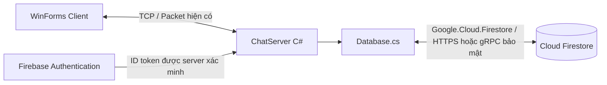

Tích hợp Firebase vào ChatApp.Nhom1
=================================

Tài liệu đối chiếu source và tài liệu chính thức ngày 30/10/2026. Hướng mới là lưu dữ liệu nghiệp vụ trực tiếp vào Firebase, thay cho phương án MemoryChatStore/Supabase trong hướng dẫn trước. Chưa cài package vào project chính, chưa sửa protocol/client và chưa kết nối tới một Firebase project thật. Các đoạn code là hướng dẫn tích hợp.

Đã trích toàn bộ class Database ở phần 6 sang project tạm tham chiếu Shared hiện tại, restore `Google.Cloud.Firestore` **4.6.0** và build với .NET 10: **0 warning, 0 error**. Đây là kiểm tra biên dịch/API, chưa xác nhận credentials, IAM, index hoặc giao dịch trên cloud. Các phần auth/handler ghép thêm chưa được kiểm thử đầu cuối.

1. Chọn dịch vụ và giữ kiến trúc client–server
---------------------------------------------

Tôi đề xuất **Cloud Firestore Standard edition**, database `(default)`, cho dữ liệu đồ án. Thư viện C# phía server là `Google.Cloud.Firestore`. Không dùng Firebase Realtime Database trong hướng dẫn này. [Firestore .NET](https://docs.cloud.google.com/dotnet/docs/reference/Google.Cloud.Firestore/latest/index.html).



| Thành phần Firebase | Trách nhiệm trong đồ án |
|---|---|
| Cloud Firestore | Hồ sơ, quan hệ bạn bè, nhóm, tin nhắn, mốc đã đọc, metadata file |
| Firebase Authentication | Xác thực tài khoản Email/SĐT/Google; không phải collection mật khẩu |
| Cloud Storage for Firebase | File/ảnh/video nhị phân nếu chọn lưu trên Firebase |
| Firebase Cloud Messaging | Dịch vụ push riêng; không mặc nhiên hoàn thiện push cho WinForms chỉ bằng cách thêm database |

Không đưa service account vào ChatApp.Client. Client vẫn gửi request tới server. Server xác thực, kiểm tra quyền, ghi Firestore thành công rồi trả response và phát event TCP. Một server như đồ án chưa cần Firestore listener để phát lại chính những tin vừa ghi, tránh gửi trùng event.

**Dữ liệu nghiệp vụ được lưu bền vững ngay.** Dictionary kết nối `UserId → ConnectedClient`, khóa gửi socket, request đang chờ và typing vẫn là trạng thái tạm trong tiến trình. Đây là phần vận hành của TCP, không phải dùng RAM thay database. IsOnline được suy ra từ phiên; không tin một cờ true còn sót sau khi server tắt.

2. Tạo project và database
-------------------------

1. Mở [Firebase Console](https://console.firebase.google.com/), tạo project, ví dụ tên hiển thị `ChatApp-Nhom1`. Google Analytics không cần cho bài chat WinForms này.
2. Vào Project settings → General, ghi lại **Project ID**. Ví dụ tên hiển thị là ChatApp-Nhom1 nhưng ID có thể là `chatapp-nhom1-a1b2c`. Dùng ID, không dùng tên hiển thị, Project number hay API key ở chỗ Project ID.
3. Vào Build → Firestore Database → Create database. Nếu có chọn edition, chọn Standard, dùng database `(default)` với Firestore Native API cho bộ code này.
4. Chọn vị trí phù hợp, gần nơi chạy server nếu có lựa chọn. Kiểm tra vị trí trước khi tạo; không coi đây là cấu hình có thể tùy ý đổi sau khi có dữ liệu.
5. Chọn **Production mode**. Tài liệu Firebase hướng dẫn chế độ này cho server C# đã xác thực. Không cần bật Test mode để server ghi được dữ liệu. [Quickstart Firestore](https://firebase.google.com/docs/firestore/quickstart).
6. Đợi database được tạo. Chưa cần tự tạo các collection hoặc nhập bảng SQL: code ghi document đầu tiên sẽ tạo collection tương ứng.

Có thể giữ rules chặn truy cập trực tiếp của client:

```text
rules_version = '2';
service cloud.firestore {
  match /databases/{database}/documents {
    match /{document=**} {
      allow read, write: if false;
    }
  }
}
```

Server SDK dùng quyền IAM và **không bị các Firestore Security Rules này kiểm soát**. Vì vậy rules chặn client vẫn cho server có quyền IAM hợp lệ hoạt động. Server phải kiểm tra quyền đọc/gửi/nhóm trong code; không chỉ dựa vào rules. [Giải thích chính thức về server SDK và rules](https://firebase.google.com/docs/firestore/security/rules-conditions).

3. Cấp thông tin kết nối cho server local
-----------------------------------------

Cách dễ theo dõi khi thực hành local: dùng service account JSON qua Application Default Credentials. Firebase hướng dẫn tạo private key ở Project settings → Service accounts → Generate new private key. [Thiết lập server credentials](https://firebase.google.com/docs/admin/setup).

Lưu JSON **ngoài repository**, ví dụ:

```text
C:\Users\longlong\.config\chatapp\firebase-service-account.json
```

Nếu giao diện không cho xuất key, kiểm tra chính sách tổ chức/tài khoản quản trị; không cần chuyển rules sang công khai. Với tài khoản có quyền phát triển thích hợp, ADC từ Google Cloud CLI là một lựa chọn khác. Bộ hướng dẫn này chỉ cần chọn một cách xác thực server.

Trong PowerShell dùng để chạy server:

```powershell
$env:GOOGLE_APPLICATION_CREDENTIALS = "C:\Users\longlong\.config\chatapp\firebase-service-account.json"
$env:FIREBASE_PROJECT_ID = "PROJECT_ID_THAT"

Test-Path -LiteralPath $env:GOOGLE_APPLICATION_CREDENTIALS
```

Thay `PROJECT_ID_THAT` bằng Project ID thực tế. `Test-Path` trả True chỉ xác nhận file có tồn tại, chưa xác nhận quyền truy cập database. Không in nội dung JSON hoặc private_key để debug. JSON của server là bí mật; không gửi kèm client, không dán vào chat, không commit Git.

Các biến `$env:` trên chỉ áp dụng cho terminal hiện tại và tiến trình con. Chạy `dotnet run` từ chính terminal đó. Visual Studio đã mở từ trước không tự nhận các biến mới của terminal. Nếu muốn F5, cấu hình biến môi trường cho phiên debug hoặc mở Visual Studio từ môi trường đã cấu hình; không nhét private key vào source hay launchSettings.

Có thể bổ sung các tên file cụ thể vào `.gitignore` như lớp bảo vệ phụ:

```gitignore
**/firebase-service-account*.json
**/*-firebase-adminsdk-*.json
**/secrets/
```

Firestore sử dụng quyền IAM, chẳng hạn Cloud Datastore User (`roles/datastore.user`) cho đọc/ghi dữ liệu. Tài khoản dùng thêm Firebase Auth có thể cần quyền tương ứng cho thao tác Auth. Nếu lỗi PermissionDenied, kiểm tra danh tính service account, project và IAM; sửa rules sang `true` không chữa được thiếu quyền IAM. [Quyền server Firestore](https://docs.cloud.google.com/firestore/native/docs/security/iam).

4. Cài thư viện đúng project
---------------------------

Chạy từ thư mục solution:

```powershell
dotnet add .\ChatApp.Server\ChatApp.Server.csproj package Google.Cloud.Firestore
```

Chỉ cài vào **Server**. Các DTO hiện tại trong Shared vẫn là kiểu C# thông thường. Khi triển khai xác thực Firebase, cài thêm:

```powershell
dotnet add .\ChatApp.Server\ChatApp.Server.csproj package FirebaseAdmin
```

`Google.Cloud.Firestore` thực hiện đọc/ghi Firestore; `FirebaseAdmin` thực hiện các chức năng quản trị/xác minh Firebase Auth. Chỉ thêm FirebaseAdmin chưa thay thế thư viện Firestore. Lệnh add ghi phiên bản được resolve vào csproj để các thành viên restore cùng phiên bản; commit csproj, không commit credentials.

5. Thiết kế dữ liệu khớp source hiện tại
---------------------------------------

Firestore dùng **collection → document → field**. Ví dụ `users/1` là document ID chuỗi `"1"`, bên trong vẫn có field `Id` là số 1. Không có JOIN hoặc IDENTITY như SQL Server; unique và quan hệ cần được đảm bảo bằng thiết kế document và transaction.

Giữ ID nghiệp vụ **int** vì UserSummary, GroupSummary, MessageSummary và cursor trong protocol đang dùng int. Firebase Auth UID là một định danh khác; ánh xạ qua `authUsers/{uid}`. Không sửa toàn bộ DTO sang string ở bước nối database.

```text
users/{Id dạng chuỗi}
  Id: number
  FirebaseUid: string
  Username: string          // lowercase, 3–50 chữ/số/underscore
  DisplayName: string
  CreatedAt: timestamp

authUsers/{FirebaseUid đã escape thành một path segment}
  UserId: number

usernames/{username đã chuẩn hóa}
  UserId: number            // giữ duy nhất username

friends/{minUserId}_{maxUserId}
  UserInvite: number
  UserReceive: number
  Participants: [number, number]
  Status: "Pending" hoặc "Accepted"
  CreatedAt: timestamp

groups/{GroupId dạng chuỗi}
  Id: number
  GroupName: string
  CreatedBy: number
  MemberIds: [number, ...]  // tối đa 20 theo protocol hiện tại
  CreatedAt: timestamp

messages/{MessageId dạng chuỗi}
  Id: number
  ConversationKey: "direct_1_2" hoặc "group_5"
  SenderId: number
  ReceiverId: number hoặc null
  GroupId: number hoặc null
  Content: string
  SendTime: timestamp

readStates/{UserId}_{ConversationKey}
  UserId: number
  ConversationKey: string
  LastReadMessageId: number

attachments/{FileId}
  MessageId, StorageObjectPath, FileName, Size, ContentType, ...

counters/users
  LastId: number
counters/groups
  LastId: number
counters/messages
  LastId: number
```

`direct_1_2` dùng ID nhỏ trước, nên cả hai chiều nằm trong một hội thoại. SenderId vẫn thể hiện chiều gửi. Friends cũng sắp thứ tự ID ở document key nhưng giữ nguyên UserInvite/UserReceive trong fields.

Counter tăng bằng **transaction trong Firestore**, không dùng `_nextId++` trong RAM và không đếm số document để cấp ID. Counter tập trung là lựa chọn dễ hiểu cho đồ án ít người; có tranh chấp và thêm lượt đọc/ghi khi tải lớn, không phải thiết kế mở rộng vô hạn.

Không chứa toàn bộ lịch sử trong một mảng của document group. Mỗi tin là một document để tải phân trang và tránh giới hạn kích thước document. Firestore giới hạn một document 1 MiB; ảnh/video lưu ngoài document, Firestore giữ metadata. [Giới hạn Firestore](https://firebase.google.com/docs/firestore/quotas).

6. Code Database.cs: kết nối, hồ sơ, gửi và đọc tin
-------------------------------------------------

File `ChatApp.Server/Database.cs` hiện rỗng. Mẫu bên dưới thay nội dung file đó khi bắt đầu triển khai. Nó dùng DTO đang có trong Shared, không cần Firestore attribute trong Shared. Mọi phương thức truy cập mạng đều async.

`EnsureProfileAsync` chỉ được gọi với UID **server đã xác minh**, không lấy UID bất kỳ từ payload. Nó tạo hồ sơ ứng dụng, không đăng ký tài khoản Firebase Auth. `SendMessageAsync` kiểm tra quan hệ/thành viên trong cùng transaction lưu tin. Các hàm tạo quan hệ/nhóm được mô tả ở phần 10.

```csharp
using System.Globalization;
using System.Text;
using System.Text.RegularExpressions;
using ChatApp.Shared.Contracts;
using Google.Cloud.Firestore;

namespace ChatApp.Server;

public sealed class Database
{
    private readonly FirestoreDb _db;

    public Database(string projectId)
    {
        if (string.IsNullOrWhiteSpace(projectId))
            throw new ArgumentException("Thiếu Firebase Project ID.");
        _db = FirestoreDb.Create(projectId);
    }

    private static string Key(int id) => id.ToString(CultureInfo.InvariantCulture);
    private static string Pair(int a, int b)
        => a < b ? $"{Key(a)}_{Key(b)}" : $"{Key(b)}_{Key(a)}";
    private DocumentReference User(int id) => _db.Collection("users").Document(Key(id));

    // Chạy ở mốc kiểm tra kết nối, không chạy cho mỗi tin nhắn.
    public async Task CheckConnectionAsync(CancellationToken ct = default)
    {
        var doc = _db.Collection("diagnostics").Document("server-connection");
        await doc.SetAsync(new Dictionary<string, object>
        {
            ["CheckedAt"] = FieldValue.ServerTimestamp,
            ["Application"] = "ChatApp.Server"
        }, cancellationToken: ct);
        var result = await doc.GetSnapshotAsync(ct);
        if (!result.Exists) throw new IOException("Không đọc lại được document kiểm tra.");
    }

    private static UserSummary ReadUser(DocumentSnapshot doc)
        => new(doc.GetValue<int>("Id"), doc.GetValue<string>("Username"),
            doc.GetValue<string>("DisplayName"), false);

    public async Task<UserSummary?> GetUserAsync(int id, CancellationToken ct = default)
    {
        if (id <= 0) throw new ArgumentOutOfRangeException(nameof(id));
        var doc = await User(id).GetSnapshotAsync(ct);
        return doc.Exists ? ReadUser(doc) : null;
    }

    public async Task<UserSummary> EnsureProfileAsync(string verifiedUid,
        string username, string displayName, CancellationToken ct = default)
    {
        username = username.Trim().ToLowerInvariant();
        displayName = displayName.Trim();
        if (string.IsNullOrWhiteSpace(verifiedUid)
            || !Regex.IsMatch(username, "^[a-z0-9_]{3,50}$")
            || displayName.EnumerateRunes().Count() is < 1 or > 100
            || displayName.Any(char.IsControl))
            throw new InvalidOperationException("INVALID_REQUEST");

        var mappingRef = _db.Collection("authUsers")
            .Document(Uri.EscapeDataString(verifiedUid));
        var nameRef = _db.Collection("usernames").Document(username);
        var counterRef = _db.Collection("counters").Document("users");

        return await _db.RunTransactionAsync(async tx =>
        {
            var mapping = await tx.GetSnapshotAsync(mappingRef);
            if (mapping.Exists)
            {
                var existing = await tx.GetSnapshotAsync(User(mapping.GetValue<int>("UserId")));
                if (!existing.Exists) throw new InvalidDataException("Hồ sơ không nhất quán.");
                return ReadUser(existing);
            }
            // Tất cả các lần đọc trước các lần ghi trong transaction.
            var name = await tx.GetSnapshotAsync(nameRef);
            var counter = await tx.GetSnapshotAsync(counterRef);
            if (name.Exists) throw new InvalidOperationException("USERNAME_TAKEN");
            int next = checked((counter.Exists ? counter.GetValue<int>("LastId") : 0) + 1);
            tx.Set(counterRef, new Dictionary<string, object> { ["LastId"] = next });
            tx.Create(User(next), new Dictionary<string, object>
            {
                ["Id"] = next, ["FirebaseUid"] = verifiedUid,
                ["Username"] = username, ["DisplayName"] = displayName,
                ["CreatedAt"] = FieldValue.ServerTimestamp
            });
            tx.Create(mappingRef, new Dictionary<string, object> { ["UserId"] = next });
            tx.Create(nameRef, new Dictionary<string, object> { ["UserId"] = next });
            return new UserSummary(next, username, displayName, false);
        }, cancellationToken: ct);
    }

    public async Task<(MessageSummary Message, int[] Recipients)> SendMessageAsync(
        int me, int? receiverId, int? groupId, string content,
        CancellationToken ct = default)
    {
        if (me <= 0 || receiverId.HasValue == groupId.HasValue
            || receiverId is <= 0 || groupId is <= 0
            || string.IsNullOrWhiteSpace(content)
            || content.EnumerateRunes().Count() > 2000
            || Encoding.UTF8.GetByteCount(content) > 4000
            || content.Any(c => char.IsControl(c) && c is not ('\t' or '\r' or '\n')))
            throw new InvalidOperationException("INVALID_REQUEST");

        var counterRef = _db.Collection("counters").Document("messages");
        return await _db.RunTransactionAsync(async tx =>
        {
            var sender = await tx.GetSnapshotAsync(User(me));
            if (!sender.Exists) throw new InvalidOperationException("NOT_AUTHENTICATED");
            int[] recipients;
            string conversation;
            if (receiverId is int peer)
            {
                var other = await tx.GetSnapshotAsync(User(peer));
                var friendship = await tx.GetSnapshotAsync(
                    _db.Collection("friends").Document(Pair(me, peer)));
                if (!other.Exists) throw new InvalidOperationException("NOT_FOUND");
                if (me == peer || !friendship.Exists
                    || friendship.GetValue<string>("Status") != "Accepted")
                    throw new InvalidOperationException("NOT_FRIENDS");
                recipients = new[] { peer };
                conversation = "direct_" + Pair(me, peer);
            }
            else
            {
                var group = await tx.GetSnapshotAsync(
                    _db.Collection("groups").Document(Key(groupId!.Value)));
                if (!group.Exists) throw new InvalidOperationException("FORBIDDEN");
                var members = group.GetValue<int[]>("MemberIds");
                if (!members.Contains(me)) throw new InvalidOperationException("FORBIDDEN");
                recipients = members.Where(id => id != me).Distinct().ToArray();
                conversation = "group_" + Key(groupId.Value);
            }
            var counter = await tx.GetSnapshotAsync(counterRef);
            int next = checked((counter.Exists ? counter.GetValue<int>("LastId") : 0) + 1);
            // Thời gian máy server UTC; không lấy từ client.
            DateTime utc = DateTime.UtcNow;
            var message = new MessageSummary(next, me, receiverId, groupId,
                content, new DateTimeOffset(utc));
            tx.Set(counterRef, new Dictionary<string, object> { ["LastId"] = next });
            tx.Create(_db.Collection("messages").Document(Key(next)),
                new Dictionary<string, object?>
                {
                    ["Id"] = next, ["ConversationKey"] = conversation,
                    ["SenderId"] = me, ["ReceiverId"] = receiverId,
                    ["GroupId"] = groupId, ["Content"] = content,
                    ["SendTime"] = Timestamp.FromDateTime(utc)
                });
            return (message, recipients);
        }, cancellationToken: ct);
    }

    private static MessageSummary ReadMessage(DocumentSnapshot doc)
        => new(doc.GetValue<int>("Id"), doc.GetValue<int>("SenderId"),
            doc.GetValue<int?>("ReceiverId"), doc.GetValue<int?>("GroupId"),
            doc.GetValue<string>("Content"),
            new DateTimeOffset(doc.GetValue<Timestamp>("SendTime").ToDateTime()));

    public async Task<HistoryResult> GetHistoryAsync(int me, int? peerId,
        int? groupId, int? beforeId, int limit = 10, CancellationToken ct = default)
    {
        if (me <= 0 || peerId.HasValue == groupId.HasValue
            || peerId is <= 0 || groupId is <= 0 || peerId == me
            || beforeId is <= 0 || limit is < 1 or > 10)
            throw new InvalidOperationException("INVALID_REQUEST");

        // Đọc quyền và lịch sử trong transaction để nhất quán với thay đổi thành viên.
        return await _db.RunTransactionAsync(async tx =>
        {
            var current = await tx.GetSnapshotAsync(User(me));
            if (!current.Exists) throw new InvalidOperationException("NOT_AUTHENTICATED");
            string conversation;
            if (peerId is int peer)
            {
                var other = await tx.GetSnapshotAsync(User(peer));
                if (!other.Exists) throw new InvalidOperationException("NOT_FOUND");
                // Sau xóa bạn vẫn đọc lịch sử chung theo protocol hiện tại.
                conversation = "direct_" + Pair(me, peer);
            }
            else
            {
                var group = await tx.GetSnapshotAsync(
                    _db.Collection("groups").Document(Key(groupId!.Value)));
                if (!group.Exists || !group.GetValue<int[]>("MemberIds").Contains(me))
                    throw new InvalidOperationException("FORBIDDEN");
                conversation = "group_" + Key(groupId.Value);
            }
            Query query = _db.Collection("messages")
                .WhereEqualTo("ConversationKey", conversation).OrderByDescending("Id");
            if (beforeId is int before) query = query.WhereLessThan("Id", before);
            var snapshot = await tx.GetSnapshotAsync(query.Limit(limit + 1));
            var items = snapshot.Documents.Take(limit).Select(ReadMessage)
                .OrderBy(m => m.Id).ToArray();
            int? next = snapshot.Count > limit ? items[0].Id : null;
            return new HistoryResult(items, next);
        }, cancellationToken: ct);
    }
}
```

Tạo một instance Database dùng chung cho server, không tạo client Firestore mới cho mỗi packet. Các lỗi nghiệp vụ dùng InvalidOperationException với code ngắn trong mẫu để dễ đọc; khi ghép dispatcher, nên dùng lớp exception chứa Code riêng và chỉ trả mã lỗi đã định nghĩa. Không trả nguyên nội dung exception cloud/stack trace cho client.

Firestore có thể chạy lại callback transaction khi tranh chấp. Vì vậy **không gửi TCP, hiện thông báo hoặc tăng biến RAM trong callback**. Chỉ sau khi `RunTransactionAsync` hoàn thành mới phát response/event. Các lần đọc đặt trước ghi. [Transaction Firestore](https://firebase.google.com/docs/firestore/manage-data/transactions).

`DateTime.UtcNow` trong SendMessage dùng đồng hồ server để response/event/history có cùng SendTime. Nếu cần chính thời điểm commit do Firestore cấp, dùng ServerTimestamp rồi đọc document sau commit trước khi dựng DTO. Không trộn thời gian local với UTC hoặc trả giá trị sentinel ServerTimestamp thẳng ra socket.

7. Nối Database vào Program và ChatServer
-----------------------------------------

Trong `Program.cs`, tại chỗ đang tạo `new ChatServer()`, thay bằng đoạn sau sau khi đã sửa constructor ChatServer:

```csharp
string projectId = Environment.GetEnvironmentVariable("FIREBASE_PROJECT_ID")
    ?? throw new InvalidOperationException("Chưa cấu hình FIREBASE_PROJECT_ID.");

var database = new Database(projectId);
await database.CheckConnectionAsync(cancellation.Token);
Console.WriteLine("Đã đọc/ghi Firestore thành công.");

var server = new ChatServer(database);
await server.Run(5000, cancellation.Token);
```

Thêm field/constructor trong `ChatServer.cs`:

```csharp
private readonly Database _database;

public ChatServer(Database database)
{
    _database = database;
}
```

Đây là các đoạn thay thế vị trí tương ứng, không dán thêm một lần `server.Run` bên dưới lệnh Run cũ. CheckConnection là phép thử ghi/đọc thật, vì chỉ gọi FirestoreDb.Create chưa chứng minh kết nối thành công. Sau mốc thiết lập, có thể bỏ phép ghi diagnostics mỗi lần khởi động hoặc chuyển thành kiểm tra chủ động.

Trong Program, ngoài SocketException đang có, xử lý OperationCanceledException khi Ctrl+C và lỗi cấu hình/cloud để log ngắn ở server. Với Firestore lỗi khi khởi động, dừng hoặc báo rõ trạng thái không sẵn sàng; không âm thầm chuyển sang RAM rồi thông báo đã lưu.

Trong `ConnectedClient.cs`, thêm `public int? UserId { get; set; }`; đây là ID ứng dụng sau xác thực, khác Id kết nối demo. Khi handler chat.send đã đọc/validate payload và phiên:

```csharp
// Trong handler phía server; các biến input lấy từ payload đã kiểm tra.
var saved = await _database.SendMessageAsync(
    sender.UserId!.Value, input.ReceiverId, input.GroupId, input.Content, ct);

// Bây giờ mới trả chat.send.response với new MessageResult(saved.Message).
// Phát chat.message.event cùng Message cho saved.Recipients đang online.
```

Envelope response/event giữ nguyên quy ước trong `docs/protocol.md`. Không sửa ProtocolClient. Server hiện chỉ có nhánh `chat`, nên thêm kết nối Firestore không tự tạo handler `auth`, `friend`, `chat.send/history`, `group`.

Nếu lưu thất bại thì không báo đã gửi. Nếu lưu thành công nhưng TCP phản hồi thất bại, client có thể timeout dù tin đã tồn tại. Không tự retry tạo tin; đồng bộ history trước. Nếu cần tự retry an toàn, bổ sung một khóa thao tác bền vững theo user và operation ID trong Firestore theo thỏa thuận protocol; RequestId hiện chỉ ghép phản hồi, chưa có hợp đồng chống lặp.

8. Index cho truy vấn lịch sử
-----------------------------

Truy vấn mẫu lọc ConversationKey và sắp xếp Id. Trong Firestore → Indexes, tạo composite index cho collection `messages`, query scope Collection:

| Field | Order |
|---|---|
| ConversationKey | Ascending |
| Id | Descending |

Đợi index sẵn sàng rồi thử lại. Khi thiếu index, Firestore thường trả lỗi có đường dẫn tạo index đúng truy vấn; chỉ mở đường dẫn trong log server quản trị, không trả chi tiết này cho client. [Quản lý index](https://firebase.google.com/docs/firestore/query-data/indexing).

Các truy vấn khác như groups MemberIds array-contains kết hợp OrderBy(Id) cũng có thể cần composite index. Không chữa thiếu index bằng cách tải toàn bộ messages rồi lọc trong RAM.

9. Firebase Authentication ghép với user ứng dụng
-------------------------------------------------

**Firestore không tự thực hiện đăng nhập.** Chọn Firebase Authentication để quản lý mật khẩu/provider. Không lưu Password hoặc SHA256 từ form vào collection users. Bật Email/Password tại Authentication → Sign-in method khi triển khai mốc email.

FirebaseAdmin có API tạo/quản lý tài khoản và xác minh ID token; không dùng nó như hàm client đăng nhập bằng mật khẩu. Với WinForms, có thể dùng Firebase Auth REST API qua HttpClient cho email/password: `accounts:signUp` và `accounts:signInWithPassword`. Phản hồi có idToken/localId; Web API key dùng ở lời gọi này khác với service-account private key. [Auth REST API](https://firebase.google.com/docs/reference/rest/auth).

Luồng đề xuất:

```text
WinForms → Firebase Auth qua HTTPS → nhận ID token
WinForms → chat server: yêu cầu xác thực bằng ID token
Server → FirebaseAdmin.VerifyIdTokenAsync → UID đáng tin cậy
Server → authUsers/{UID} → user ID int
Server → gắn ConnectedClient.UserId → trả UserSummary → mở MainForm
```

Mẫu khởi tạo Admin một lần trong Program khi triển khai auth:

```csharp
using FirebaseAdmin;
using FirebaseAdmin.Auth;
using Google.Apis.Auth.OAuth2;

FirebaseApp.Create(new AppOptions
{
    Credential = GoogleCredential.GetApplicationDefault(),
    ProjectId = projectId
});
```

Mẫu xử lý sau khi đã có ID token từ client:

```csharp
FirebaseToken verified = await FirebaseAuth.DefaultInstance.VerifyIdTokenAsync(idToken);
// Với tài khoản chưa có profile: yêu cầu username/displayName hợp lệ rồi tạo profile.
UserSummary user = await database.EnsureProfileAsync(
    verified.Uid, username, displayName, ct);
// Gắn phiên online nguyên tử rồi trả user with { IsOnline = true }.
```

Tại login thông thường, đọc mapping authUsers để lấy hồ sơ hiện có; không bắt nhập lại username/displayName ở mọi lần login. EnsureProfile dành cho hoàn thiện hồ sơ lần đầu và retry bước đó; không đổi tên profile đã tồn tại. Khi Auth tạo tài khoản thành công nhưng lưu profile lỗi, cho phép đăng nhập lại rồi hoàn thiện profile, không đăng ký một tài khoản Auth mới.

Chỉ tin UID từ kết quả verify; không nhận client gửi `{Uid: ...}` rồi coi đã đăng nhập. Tài liệu Firebase xác nhận VerifyIdToken dùng cho **ID token**, không phải custom token. [Xác minh token](https://firebase.google.com/docs/auth/admin/verify-id-tokens). Không log token; truyền token tới chat server qua TLS khi dùng tài khoản thật. Xác minh HTTPS với Firebase không tự mã hóa kết nối TCP của ứng dụng.

Phần protocol hiện định nghĩa auth.login bằng Username/Password. Vì đang giữ phần protocol do thành viên khác phụ trách, cần thống nhất request token riêng hoặc thay DTO auth khi ghép; không nhét ID token vào Password rồi diễn giải ngầm. Kết nối database, thiết kế collections và các hàm lưu tin không cần chờ đổi protocol này, nhưng đăng nhập Firebase hoàn chỉnh cần điểm ghép đó.

SĐT và Google thêm provider về sau; cuối cùng cũng ánh xạ UID sang user ID theo cùng đường. Không coi việc có thêm trường Email/Phone trong document là đã xác thực quyền sở hữu email/số điện thoại.

10. Viết từng tính năng trực tiếp lên Firestore
----------------------------------------------

**Bạn bè:** viết các hàm async trong Database hoặc tách FriendRepository khi file dài. Với đồ án, bắt đầu trong Database vẫn được.

| Hàm | Đọc/ghi cần làm |
|---|---|
| SendFriendRequestAsync(me, other) | Transaction đọc users của hai phía và friends/pair; chặn tự mời/trùng/đã là bạn; Create Pending kèm Participants |
| RespondFriendAsync(me, inviter, accept) | Transaction đọc friends/pair; kiểm tra Pending và UserReceive==me; Update Accepted hoặc Delete |
| RemoveFriendAsync(me, other) | Transaction kiểm tra Accepted rồi Delete; không xóa messages |
| GetFriendsAsync(me, status) | Query Participants array-contains me, Status đúng; ghép hồ sơ các user còn lại |

Đọc quan hệ và cập nhật cùng transaction, không `GetSnapshot` rồi `Set` độc lập để tránh hai lời mời chéo tạo trạng thái sai. Không cho client tự ghi Status=Accepted.

Firestore không JOIN users; server lấy hồ sơ theo ID bằng các lần đọc có kiểm soát hoặc GetAllSnapshotsAsync. Để giữ cursor hiện tại của friend.list, phải sắp theo ID người còn lại. Với quy mô lớp học, có thể đọc toàn bộ quan hệ của một user, sắp/filter/phân trang tại server; dữ liệu gốc vẫn ở Firestore, nhưng cách này tốn lượt đọc và cần thay thiết kế khi danh sách lớn. Không trả cursor theo ID người mời nếu UI mong ID người còn lại.

**Tìm người:** protocol hiện yêu cầu tìm chuỗi con trong username/displayName, không chỉ tiền tố. Bộ query `Google.Cloud.Firestore` dùng ở đây không cung cấp phép string Contains tương đương LINQ trong các query thông thường. Với dữ liệu nhỏ, server có thể quét users theo từng trang Id, lọc bằng OrdinalIgnoreCase và gom đủ Limit+1 kết quả khớp; trả cursor theo ID kết quả cuối được trả, không theo document đã quét cuối cùng để không bỏ sót. Việc lọc này chỉ xử lý kết quả đọc, không thay lưu trữ bằng RAM. Khi dữ liệu lớn cần thiết kế chỉ mục tìm kiếm/dịch vụ tìm kiếm phù hợp hoặc thống nhất đổi yêu cầu; không âm thầm đổi substring thành prefix. Không hứa rằng một truy vấn bắt đầu bằng username sẽ giữ nguyên hành vi tìm kiếm hiện tại.

**Nhóm:** với giới hạn 20 người, MemberIds dạng array dễ hiểu. CreateGroup dùng transaction: đọc tài khoản/quan hệ Accepted của các người được thêm, kiểm tra tên và số lượng, đọc counters/groups, tạo groups và tăng counter. Chủ nhóm luôn nằm trong MemberIds. Thêm/xóa thành viên phải đọc group, kiểm tra CreatedBy, quan hệ và trần số lượng trong transaction; không chỉ dùng ArrayUnion mà bỏ qua điều kiện nghiệp vụ. Group list có thể query WhereArrayContains("MemberIds", me); membership event phát sau commit. Gửi/history đã có mẫu kiểm tra group trong phần 6.

**Đã xem:** lưu readStates theo user+hội thoại. Transaction đọc tin được đánh dấu và quyền hội thoại, xác nhận tin thuộc đúng hội thoại, cập nhật `max(old, requested)`. Đọc lại mốc khi reconnect. Không cập nhật LastReadMessageId chỉ vì event đã đến socket. Typing không cần ghi Firestore cho mỗi ký tự; phát qua TCP và tự hết hạn.

**File:** lưu bytes ở Cloud Storage hoặc thư mục file của server; Firestore giữ MessageId, đường dẫn object nội bộ và metadata. Luồng hoàn tất: upload thành công → ghi metadata/tin nhắn → phát event. Upload thất bại hoặc ghi metadata thất bại phải có bước dọn file; transaction Firestore không bao trùm thao tác Storage. Không lưu chuỗi Base64 của video vào messages. Không phát URL công khai vô thời hạn nếu muốn kiểm tra quyền download qua server.

**Thông báo:** socket event/NotifyIcon vẫn hoạt động độc lập với database. Firestore giữ tin và lời mời để tải lại sau offline; cần unread/readstate để biết phần chưa đọc. Database không tự làm Windows hiển thị thông báo khi tiến trình đã thoát.

11. Kiểm tra mốc tích hợp và lỗi thường gặp
------------------------------------------

Trong terminal có đủ biến môi trường:

```powershell
dotnet build .\ChatApp.Nhom1.slnx
dotnet run --project .\ChatApp.Server\ChatApp.Server.csproj
```

Nếu server cũ đang chạy khóa DLL, dừng đúng phiên debug trước khi build; không kết luận lỗi Firebase từ lỗi MSBuild không copy được file.

Mốc kiểm tra đầu tiên: server in thông báo thành công **sau** CheckConnectionAsync, Firestore Console xuất hiện `diagnostics/server-connection` với CheckedAt. Chỉ mốc này mới chứng minh server thực sự ghi và đọc được cloud.

Sau khi có auth/friend/group handler, nghiệm thu tiếp:

1. Đăng ký Firebase Auth, hoàn thiện profile; kiểm tra users/authUsers/usernames/counters được tạo nhất quán. Hai lần hoàn thiện cùng UID trả cùng ID; hai UID cùng username bị chặn.
2. Hai user gửi và nhận lời mời, database chuyển Pending → Accepted đúng người có quyền.
3. Gửi tin riêng, nhận cùng Message.Id ở hai phía. Cùng lúc user thứ ba online không được nhận hoặc đọc tin đó.
4. Tạo hơn 10 tin, tải history qua nhiều trang; kiểm tra Id tăng khi hiển thị, BeforeId giảm khi tải cũ.
5. Tắt toàn bộ server và client, chạy lại, đăng nhập lại: tài khoản/hồ sơ, quan hệ, nhóm và lịch sử vẫn tồn tại. Phiên online cũ không còn.
6. Xóa thành viên nhóm rồi gọi lại send/history phải bị từ chối.
7. Ngắt Internet của server: không báo lưu thành công khi chưa biết kết quả; không tự fallback RAM hoặc tự gửi lại mutation.

| Lỗi | Cần kiểm tra |
|---|---|
| Default credentials not found | Biến GOOGLE_APPLICATION_CREDENTIALS và tiến trình có nhận biến không |
| File not found | Đường dẫn tuyệt đối tới JSON, không phải nội dung JSON |
| PermissionDenied | IAM của service account, đúng project, API đã bật; không phải mở rules |
| Database not found | Đã tạo `(default)` đúng Project ID chưa |
| The query requires an index | Tạo composite index đúng fields/order, đợi sẵn sàng |
| Unavailable/DeadlineExceeded | Mạng server, proxy/firewall, dịch vụ; mutation có thể đã commit |
| ResourceExhausted | Quota, lưu lượng đọc/ghi và kế hoạch tính phí |
| Login token invalid | Đúng Firebase project, dùng ID token còn hiệu lực, xác minh trên server |
| Đã kết nối database nhưng UI vẫn timeout | Server chưa có handler request đó; thêm DB không tự viết dispatcher |

Không sửa `.Result`/`.Wait()` vào WinForms để chờ database. Client gọi request async, server await DB, rồi trả kết quả. Dùng cancellation/deadline phù hợp; timeout ứng dụng không đảm bảo transaction chưa commit.

12. Quota và phạm vi hoàn thành
--------------------------------

Firestore Standard có hạn mức miễn phí, trong đó tài liệu hiện liệt kê 50.000 document reads/ngày, 20.000 writes/ngày và 1 GiB dữ liệu; điều kiện áp dụng cho database đủ điều kiện của project. Đây là quota, không phải mọi chức năng Firebase đều miễn phí. Counter, transaction retry, đọc quyền và index có thể làm một thao tác chat phát sinh nhiều lượt đọc/ghi. [Quota Firestore](https://firebase.google.com/docs/firestore/quotas).

Cloud Storage for Firebase hiện yêu cầu gói Blaze để sử dụng/duy trì truy cập theo thay đổi áp dụng từ năm 2026. Không bật Storage rồi giả định cùng điều kiện miễn phí với database. Có thể hoàn thiện Firestore trước và lưu file trên server khi chưa chọn thanh toán Storage. [Thông báo billing của Firebase Storage](https://firebase.google.com/docs/storage/faqs-storage-changes-announced-sept-2024).

Mốc đạt được sau phần 2–8 là **server kết nối cloud và có các hàm lưu/đọc dữ liệu thật**. Đăng nhập, bạn bè/nhóm và routing TCP vẫn phải ghép handler/UI theo các bước đã mô tả. Phần RAM trong hướng dẫn cũ được thay bằng các hàm Firestore async; phần kiểm tra quyền, định tuyến, cập nhật UI và timeout vẫn áp dụng.
